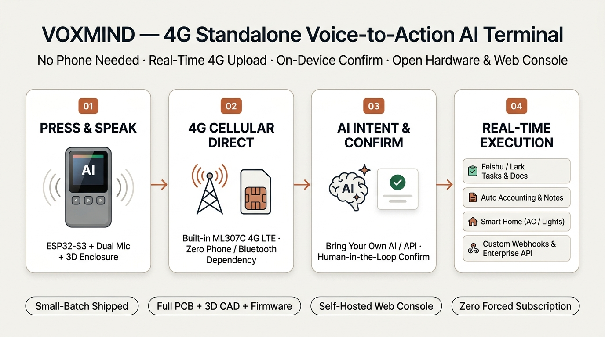
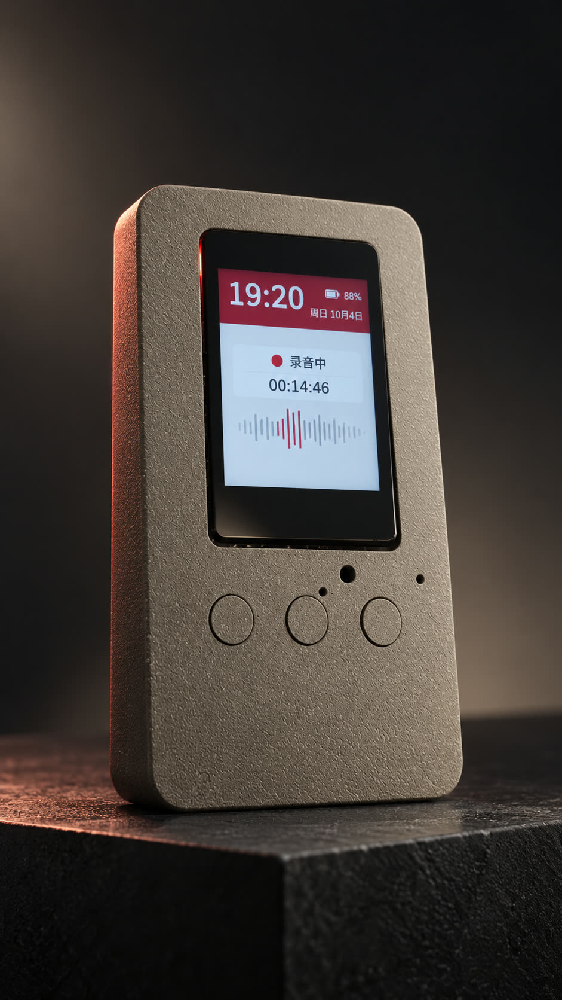
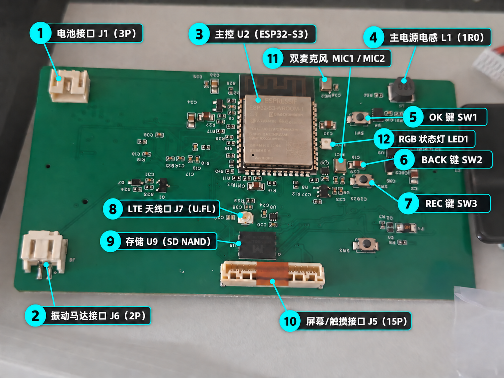
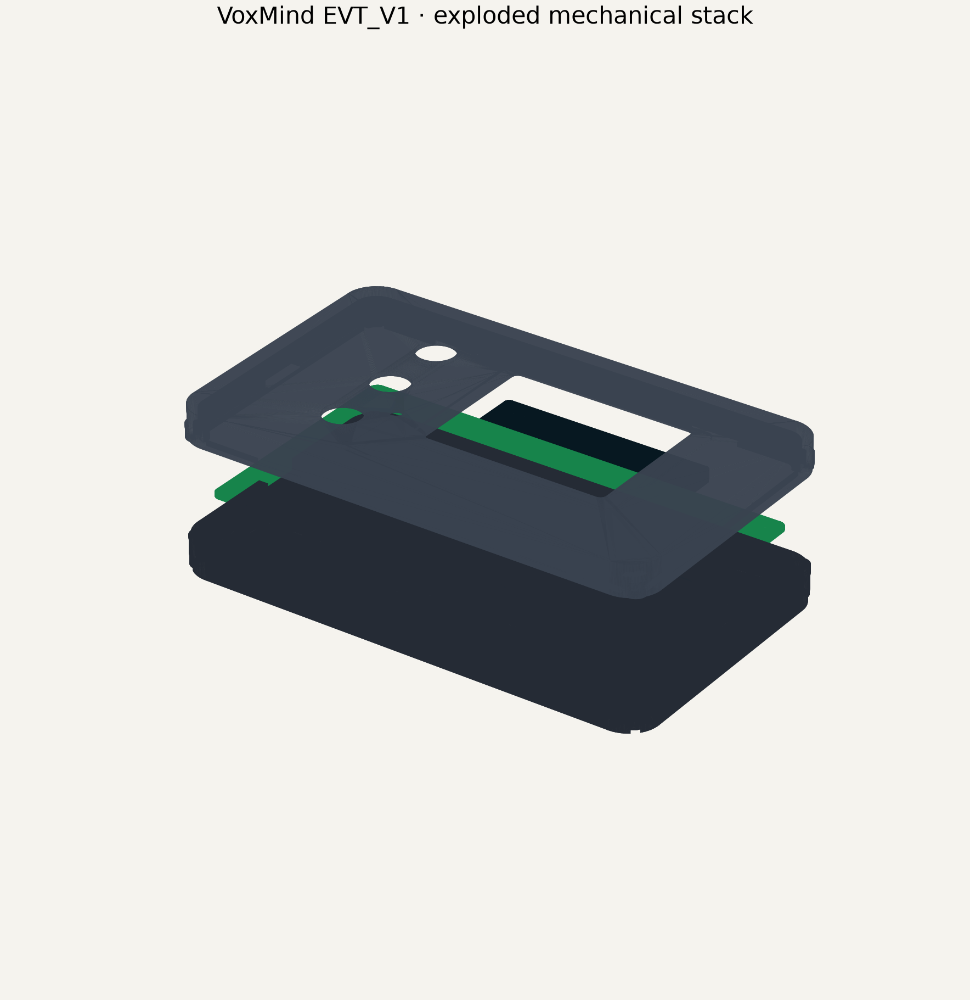
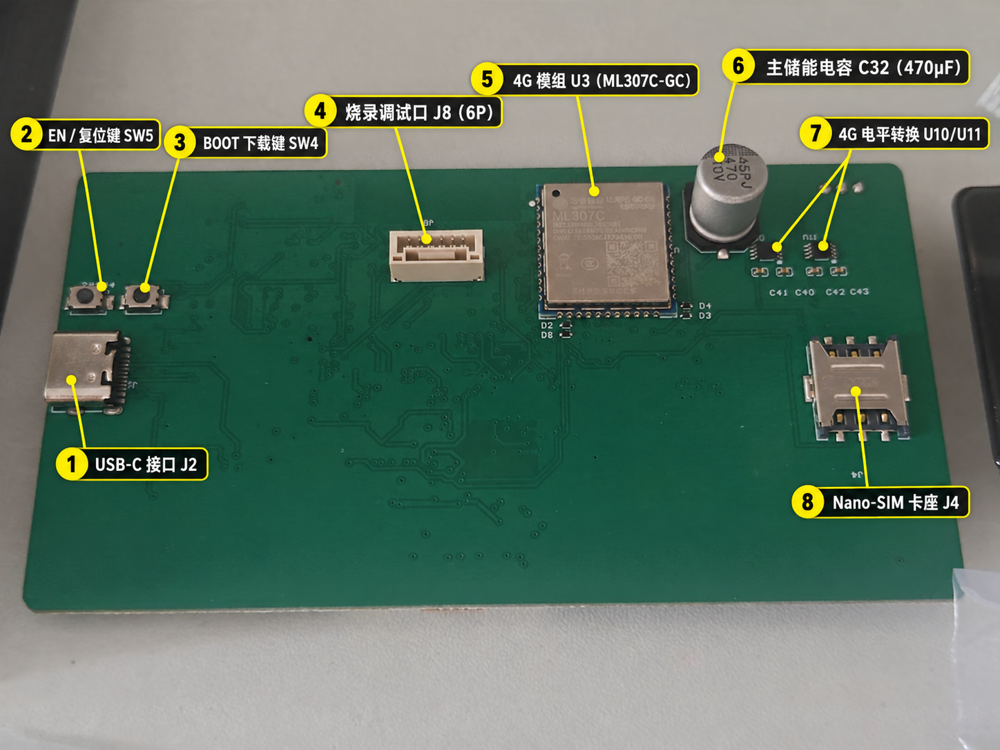
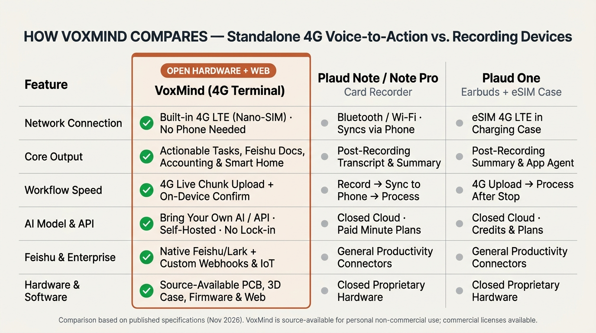

<div align="center">

# VoxMind · 4G 随身语音 AI 行动终端

**4G Standalone Voice-to-Action AI Hardware Terminal — Hardware · Firmware · 3D Enclosure · Web Console**

[中文](#中文) · [English](#english) · [日本語](#日本語) · [Español](docs/README.es.md) · [Deutsch](docs/README.de.md) · [한국어](docs/README.ko.md) · [Français](docs/README.fr.md)

[](https://m.tb.cn/h.jMFxNbJ?tk=qkTU6TNvVOc)
[](https://feishubanlv.com/voxmind/demo/)
[](https://feishubanlv.com/voxmind/)
[](https://wa.me/8617703575241)

<br>



</div>

---

## 中文

### VoxMind 是什么？

**VoxMind** 是一台**内置独立 4G 蜂窝网络**的随身 AI 语音行动终端——**不需要掏手机、不需要连蓝牙、不依赖 Wi-Fi**，按下说话即可实时通过 4G 上传语音，经 AI 理解意图后在设备屏幕弹出确认卡片，一键执行**飞书任务、飞书消息、飞书云文档、自动记账、智能家居控制（空调/灯光）以及企业自定义 API / Webhook 工作流**。

> **说明**：这里的 **4G** 指的是**内置 4G 移动蜂窝网络（Nano-SIM）**，不是 4GB 内存。本项目是独立的 4G AI 硬件终端，与同名学术论文项目无关。

### 成熟实物 · 已小批量量产与真实出货

VoxMind 不是停留在概念图或原型阶段的项目，而是**已经过小批量量产、实际售出并稳定日常运行的成熟软硬件产品**：

- **已有成品现货**：整机包含自研 4 层 PCB、ESP32-S3 主控、ML307C 4G LTE 模组、2 英寸彩色触摸屏、双麦克风、定制 **3D 打印外壳（已完整公开 v1 / v2 结构文件）**。
- **即买即用**：可直接通过闲鱼购买手工成品 —— **[个人手工制作 VoxMind｜4G 语音 AI 飞书任务终端](https://m.tb.cn/h.jMFxNbJ?tk=qkTU6TNvVOc)**。
- **全栈源码公开**：从 **PCB 原理图/制造文件（Gerber/BOM/坐标）、3D 外壳 STEP/STL、ESP32-S3 固件、TypeScript 云端与 Web 控制台，到 Docker 一键部署脚本** 全部公开（所有密钥与个人设备标识已彻底剥离，开箱安全自部署）。
- **在线体验后台**：无需硬件即可直接体验隔离演示后台 👉 **[VoxMind 在线交互 Demo](https://feishubanlv.com/voxmind/demo/)**（纯合成演示数据，不连接作者真实设备）。

<div align="center">
<table>
  <tr>
    <td align="center" width="38%">
      <br>
      <sub><b>VoxMind 实机外观</b>（定制 3D 外壳 + 2" 彩屏 + 实体三键）</sub>
    </td>
    <td align="center" width="62%">
      <br>
      <sub><b>自研 v9 四层 PCB 正面实拍</b>（ESP32-S3 / 双麦 / SD NAND / 15P 屏口）</sub>
    </td>
  </tr>
  <tr>
    <td align="center">
      <br>
      <sub><b>定制 3D 外壳结构分解</b>（仓库含 v1 & v2 完整 STEP / STL）</sub>
    </td>
    <td align="center">
      <br>
      <sub><b>自研 v9 四层 PCB 反面实拍</b>（ML307C 4G 模组 / Nano-SIM / USB-C）</sub>
    </td>
  </tr>
</table>
</div>

### 对比 Plaud（Note / Note Pro / One），VoxMind 强在哪里？

<div align="center">

</div>

| 对比维度 | **VoxMind（4G 语音行动终端）** | **Plaud Note / Note Pro** | **Plaud One** |
| :--- | :--- | :--- | :--- |
| **联网方式** | **内置 4G LTE（插 Nano-SIM）**，完全脱离手机独立联网 | 蓝牙 / Wi-Fi，需通过手机 App 同步 | 充电盒内置 eSIM 4G LTE |
| **核心能力** | **边说边办事**：直连飞书建任务/发消息/写云文档/自动记账、控智能家居、调企业 API | 录音结束后同步，主打转写与会议纪要 | 4G 边录边传，停录后生成纪要与 App Agent |
| **实时工作流** | 4G 实时分段上传 + AI 意图识别 + **机身屏幕一键确认执行** | 录完 → 同步手机 → 云端转写摘要 | 录音上传 → 停止后开始转写处理 |
| **AI 模型与订阅** | **自带 AI / API 密钥，零强制月费订阅**，支持完全自部署 | 封闭云端，超额需付费订阅分钟数套餐 | 封闭云端，按 Credits / 订阅方案计费 |
| **飞书与企业集成** | **原生深度对接飞书（任务/消息/云文档/记账）** + 开放 Webhook / Home Assistant / CRM | 通用海外效率连接器 | 通用海外效率连接器 |
| **软硬件开放度** | **PCB + 3D 外壳 + 固件 + Web 后台全栈源码公开**，可按需深度二开 | 闭源商业硬件 | 闭源商业硬件 |

### 实机演示视频（抖音实拍）

作者本人在抖音（**尼奥飞书开发 · `79786419510`**）发布的真实硬件运行演示：

- 🎬 **[自制 AI 硬件接入智能家居，一句话开关空调](https://www.douyin.com/video/7695388211157159203)** — 实机语音下发指令、屏幕确认后联动涂鸦智能与红外控制空调
- 🎬 **[自己做了个 AI 硬件：发飞书、控家居、接企业系统](https://www.douyin.com/video/7694328346280234274)** — 从屏幕驱动、PCB 到外壳组装，语音直连飞书任务与企业业务平台
- 🎬 **[我做了个能替你办事的 AI 随身入口（VoxMind 实机演示）](https://www.douyin.com/video/7691974175644339502)** — 独立 4G 持续录音、创建飞书任务、自动记账、设备端实时显示执行回执
- 🎬 **[AI 录音机 3D 外壳打印实拍，可外接智能体实时处理](https://www.douyin.com/video/7690610993400382395)** — 3D 外壳打印与插物联网卡实时接入飞书/智能体

### 仓库结构与快速上手

```text
voxmind-4g/
├── voxmind-source-available/snapshot/
│   ├── cloud/                    # TypeScript 云端后端与 Web 控制台（Node.js 20+）
│   ├── firmware/                 # ESP32-S3 固件源码（ESP-IDF，含 4G 蜂窝与屏幕 UI）
│   ├── deploy/                   # Docker Compose + Caddy 自建部署配置
│   └── 制造文件_v9_20260830/      # 最新 v9 四层 PCB 制造文件（Gerber / BOM / 坐标）
├── voxmind-hardware-extra/snapshot/
│   ├── VoxMind_EVT_V1_当前设计.eprj2  # EasyEDA 专业版完整工程
│   ├── 结构设计_v1_20260830/      # 3D 外壳 v1（STEP / STL / 预览图）
│   ├── 结构设计_v2_20260928/      # 3D 外壳 v2（STEP / STL / 装配预览）
│   └── 制造文件_v4..v8/           # 历史版本制造文件归档
├── candidates/power-off-drain/   # 关机低功耗优化分支补丁
├── docs/                         # 架构图、合规说明与多语种文档
└── LICENSE.md                    # 个人非商业源码公开许可（中/英/日全文）
```

**本地启动云端与 Web 控制台：**

```bash
cd voxmind-source-available/snapshot/cloud
cp .env.example .env   # 填入你自己的 AI API Key 与飞书应用配置（仓库不含任何生产密钥）
npm install
npm test
npm run build
```

**编译 ESP32-S3 固件：**

```bash
cd voxmind-source-available/snapshot/firmware
idf.py set-target esp32s3
idf.py build
```

### 硬件定制设计 · 商业授权 · 购买成品（中文联系微信）

如果你需要 **AI 硬件定制设计（PCB / 3D 结构 / 固件 / 云端整套交付）**、企业私有化二次开发，或购买 **VoxMind 商业授权**：

<div align="center">
<table>
  <tr>
    <td align="center">
      <br>
      <sub><b>扫码添加作者微信（中文专属）</b><br>硬件定制设计 · 企业二开 · 商业授权</sub>
    </td>
    <td align="left">
      <ul>
        <li><b>购买成品现货（闲鱼）</b>：<a href="https://m.tb.cn/h.jMFxNbJ?tk=qkTU6TNvVOc">个人手工制作 VoxMind｜4G 语音 AI 飞书任务终端</a></li>
        <li><b>在线交互 Demo</b>：<a href="https://feishubanlv.com/voxmind/demo/">https://feishubanlv.com/voxmind/demo/</a></li>
        <li><b>作者官网与项目留言</b>：<a href="https://buildwithneo.cn/#contact">https://buildwithneo.cn/#contact</a></li>
        <li><b>邮箱</b>：<code>neo.gannianlin@gmail.com</code></li>
      </ul>
    </td>
  </tr>
</table>
</div>

### 许可说明

本项目采用 **个人非商业源码公开许可（Source-Available）**：
- 允许**自然人**将原创软件、固件、硬件 PCB、3D 外壳、网站与文档用于**个人学习、兴趣制作与非商业用途**。
- **商业使用**（包括销售成品、代工量产、为企业或组织部署、集成进收费产品等）须另行向作者购买书面授权。
- 本许可不是 Open Source Initiative (OSI) 定义下的开源许可，完整条款见 [LICENSE.md](LICENSE.md)，第三方依赖与声明见 [NOTICE](NOTICE) 与 [docs/COMPLIANCE.md](docs/COMPLIANCE.md)。

---

## English

### What is VoxMind?

**VoxMind** is a **standalone 4G cellular Voice-to-Action AI hardware terminal**—engineered from the ground up with custom 4-layer PCB, ESP32-S3 MCU, ML307C 4G LTE modem (Nano-SIM), 2-inch color touch LCD, dual microphones, and a custom **3D-printed enclosure**.

No phone pairing, no Bluetooth tether, no Wi-Fi dependency. Press and speak: VoxMind streams audio directly over 4G LTE, extracts actionable intent via your choice of AI model, shows a confirmation card right on the device screen, and executes **Feishu/Lark tasks, messages, docs, automated expense logging, smart home controls (AC/lights), and custom enterprise webhooks/APIs** in real time.

> **Note**: **4G** refers to built-in **4G LTE cellular networking** (not 4 GB memory). This hardware product is unrelated to the academic speech paper sharing the same name.

### Real Hardware · Small-Batch Produced, Shipped & Battle-Tested

VoxMind is a **mature, working physical product**—small-batch manufactured, already sold and shipped to real users, and running stably in daily workflows:

- **Physical Units Ready to Order**: Available on Xianyu — **[Handmade VoxMind | 4G Voice AI Feishu Task Terminal](https://m.tb.cn/h.jMFxNbJ?tk=qkTU6TNvVOc)**.
- **Complete Stack Source-Available**: EasyEDA PCB project, v9 production Gerbers/BOM/CPL, **3D Enclosure v1 & v2 (STEP + STL)**, ESP-IDF firmware, TypeScript cloud backend & Web Console, and Docker Compose deployment—fully sanitized with **zero API keys or private device credentials**.
- **Try the Isolated Web Console Demo**: Experience the voice-to-action confirmation workflow right in your browser (100% synthetic demo data, zero connection to real hardware) 👉 **[Open Interactive Demo](https://feishubanlv.com/voxmind/demo/#en)**.

### Why VoxMind vs. Plaud Note / Note Pro / Plaud One

See the side-by-side comparison graphic above ([`docs/images/voxmind-vs-plaud.jpg`](docs/images/voxmind-vs-plaud.jpg)):

| Capability | **VoxMind (4G Terminal)** | **Plaud Note / Note Pro** | **Plaud One** |
| :--- | :--- | :--- | :--- |
| **Connectivity** | **Built-in 4G LTE (Nano-SIM)** — zero phone required | BLE / Wi-Fi — syncs via phone app | Built-in eSIM 4G LTE in charging case |
| **Core Purpose** | **Voice-to-Action**: Feishu/Lark tasks, docs, accounting, smart home & custom APIs | Post-recording transcripts & summaries | Post-recording summary & mobile app agent |
| **Workflow** | Live 4G chunk upload → AI intent → **On-device screen confirmation** | Record → Sync to phone → Process | 4G upload → Process after recording stops |
| **AI & Subscription** | **Bring Your Own AI / API** · Self-hosted · **Zero forced monthly plan** | Closed cloud · Paid minute tiers | Closed cloud · Credits & paid plans |
| **Openness** | **Full PCB + 3D CAD + Firmware + Web Console source-available** | Closed proprietary hardware | Closed proprietary hardware |

### Real Hardware Demo Videos (Douyin)

- 🎬 **[Voice-controlling AC via Smart Home on VoxMind](https://www.douyin.com/video/7695388211157159203)**
- 🎬 **[Custom AI Hardware: Feishu Tasks, Smart Home & Enterprise Systems](https://www.douyin.com/video/7694328346280234274)**
- 🎬 **[VoxMind Live 4G Demo: Tasks, Accounting & On-Device Receipts](https://www.douyin.com/video/7691974175644339502)**
- 🎬 **[3D-Printed Enclosure & Cellular IoT Agent Integration](https://www.douyin.com/video/7690610993400382395)**

### Custom Hardware Design & Commercial Licensing (Contact via WhatsApp)

Need **custom AI hardware design** (PCB layout, 3D enclosure engineering, ESP32/4G firmware, cloud backend), bespoke enterprise integrations, or a **commercial license** for VoxMind?

- 💬 **WhatsApp (International)**: **[+86 177 0357 5241](https://wa.me/8617703575241)** (`https://wa.me/8617703575241`)
- 🌐 **Website & Contact**: [https://buildwithneo.cn/#contact](https://buildwithneo.cn/#contact)
- ✉️ **Email**: `neo.gannianlin@gmail.com`

### License

VoxMind is **source-available for personal, non-commercial use** by natural persons only. Commercial use (manufacturing for sale, enterprise deployment, paid services, or commercial resale) requires a separate paid written license from the author. This is not an OSI-approved open-source license. Full legal terms (Chinese controls): [LICENSE.md](LICENSE.md) · Third-party notices: [NOTICE](NOTICE).

---

## 日本語

### VoxMind とは？

**VoxMind** は、**独立 4G セルラー通信（Nano-SIM）を内蔵した携帯型 AI 音声アクション端末**です。スマホとの Bluetooth 接続や Wi-Fi に依存せず、ボタンを押して話すだけで 4G 経由でリアルタイムに音声を送信。AI が意図を解析し、本体のカラー液晶に確認カードを表示——ワンタップで **Feishu（Lark）タスク作成・メッセージ送信・ドキュメント作成・自動家計簿・スマートホーム操作（エアコン/照明）・企業向け独自 API / Webhook** まで即座に実行します。

> **注記**：ここでの **4G** は内蔵 **4G LTE モバイル回線**を意味します（4GB メモリではありません）。同名の学術論文プロジェクトとは無関係です。

### 実機完成・小ロット量産・出荷実績あり

VoxMind はコンセプト段階ではなく、**小ロット量産・実際の販売出荷・日常での安定稼働まで完了した実用ハードウェア**です。

- **実機購入可能**：閑魚（Xianyu）にて手作り完成品を販売中 👉 **[VoxMind｜4G 音声 AI Feishu タスク端末](https://m.tb.cn/h.jMFxNbJ?tk=qkTU6TNvVOc)**
- **フルスタック・ソース公開**：4 層 PCB（EasyEDA / Gerber / BOM / 座標）、**3D 筐体データ v1 & v2（STEP / STL）**、ESP32-S3 ファームウェア、TypeScript クラウド & Web コンソール、Docker デプロイ設定まですべて公開（API キーや実機認証情報は完全に除外済み）。
- **オンライン操作デモ**：実機不要でブラウザから体験可能（完全合成データ・実機非接続）👉 **[インタラクティブ・デモを開く](https://feishubanlv.com/voxmind/demo/#ja)**

### Plaud（Note / Note Pro / One）との違い

- **スマホ不要の独立 4G**：カード型の Plaud Note / Note Pro は Bluetooth/Wi-Fi 経由でスマホ同期が必要ですが、VoxMind は本体内蔵の ML307C 4G モジュールで単体通信します（Plaud One は充電ケースに eSIM 4G LTE を内蔵）。
- **「録音要約」から「その場で実行」へ**：録音後の文字起こしに留まらず、Feishu/Lark タスク・自動記帳・スマートホーム操作・自社 API 連携までを端末画面の確認付きで完結。
- **自社 AI / API 持ち込み・月額縛りなし**：お好みの LLM / ASR API やセルフホスト構成を自由に選択でき、閉鎖型サブスクリプションに縛られません。
- **ハードもソフトもカスタマイズ可能**：PCB・3D 外装・ファームウェア・Web 管理画面のソースが公開されているため、個人学習から企業向けカスタムまで柔軟に対応できます。

### 実機動作動画（Douyin）

- 🎬 **[自作 AI ハードでスマートホーム連携：一言でエアコン操作](https://www.douyin.com/video/7695388211157159203)**
- 🎬 **[自作 AI 端末：Feishu 送信・家電操作・企業システム連携](https://www.douyin.com/video/7694328346280234274)**
- 🎬 **[VoxMind 実機デモ：独立 4G 録音・タスク作成・自動記帳](https://www.douyin.com/video/7691974175644339502)**
- 🎬 **[3D プリント筐体と IoT SIM によるエージェント連携](https://www.douyin.com/video/7690610993400382395)**

### ハードウェア受託設計・商用ライセンスのご相談（WhatsApp）

**AI ハードウェアのカスタム設計（PCB・3D 筐体・ファームウェア・クラウド一式）**や企業向け二次開発、**VoxMind の商用ライセンス**をご希望の方は、WhatsApp よりお気軽にご連絡ください：

- 💬 **WhatsApp（日本語・英語対応）**：**[+86 177 0357 5241](https://wa.me/8617703575241)** (`https://wa.me/8617703575241`)
- 🌐 **公式サイト・お問い合わせ**：[https://buildwithneo.cn/#contact](https://buildwithneo.cn/#contact)
- ✉️ **メール**：`neo.gannianlin@gmail.com`

### ライセンス

本プロジェクトは**個人の非商用利用向けソース公開（Source-Available）**です。自然人による個人学習・趣味制作・非商用利用を許可します。商用利用（販売・量産・企業導入・有料サービスへの組み込み等）には作者からの有償書面許諾が必要です。OSI 定義のオープンソースライセンスではありません。全文は [LICENSE.md](LICENSE.md)（中国語正文優先）および [NOTICE](NOTICE) をご確認ください。
