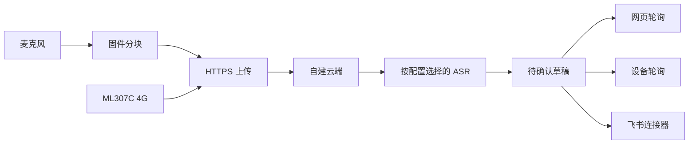
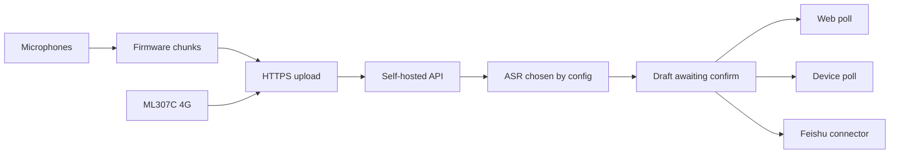
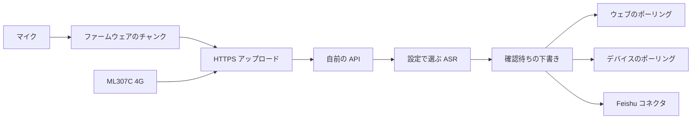

# VoxMind

个人非商业、源码公开的 4G 语音动作终端。不是 OSI 意义上的开源。

[中文](#中文) · [English](#english) · [日本語](#日本語) · [Español](docs/README.es.md) · [Deutsch](docs/README.de.md)

许可：[LICENSE.md](LICENSE.md) · 第三方：[NOTICE](NOTICE) · 来源：[ATTRIBUTION.md](ATTRIBUTION.md)

仓库：<https://github.com/wechat-numbshark/voxmind-4g>

---

## 中文

### 这是什么

VoxMind 是一台手工制作的 **4G 蜂窝**语音终端，用来把说话变成可确认的动作，例如飞书任务。这里的 4G 是移动网络，不是 4GB 内存或存储。

已经有手工实物。作者给出的闲鱼链接是 <https://m.tb.cn/h.jMFxNbJ?tk=qkTU6TNvVOc>，标题为「个人手工制作VoxMind｜4G语音AI飞书任务终端」。本仓库不核验该链接此刻是否仍可下单。

机器体积笨重，完成度还有明显的优化空间。下面不写未经本仓库证实的外形尺寸、电池容量、售价、认证或端到端延迟。制造说明里原有的 PCB 叙述，只在硬件一节按原文转述。

### 许可

只允许**自然人**把原创软件、固件、硬件设计、制造文件、网站、文档和媒体用于**自己的兴趣和非商业用途**。商业使用要另行向作者购买书面授权。

这不是 Open Source Initiative 定义下的开源许可，也不是 MIT、Apache、GPL、AGPL、CERN-OHL 或 PolyForm Noncommercial。全文见 [LICENSE.md](LICENSE.md)。第三方权利见 [NOTICE](NOTICE) 和 [docs/COMPLIANCE.md](docs/COMPLIANCE.md)。

本仓库没有经过核验的商业联系方式。不填写微信或 WhatsApp 占位账号。闲鱼链接只表示作者指出的手工实物购买入口，不是商业授权渠道。

### 仓库里有哪两条线

| 线 | 位置 | 版本 | 状态 |
| --- | --- | --- | --- |
| v7 工作快照（英国 SIM / 蜂窝配置） | `voxmind-source-available/snapshot/` | 固件 `1.0.27-uk.1` | 本仓库的软件与网站基线，未再改功能 |
| 关机掉电修复 | `candidates/power-off-drain/` 与 `patches/` | 固件 `1.0.27-power.1` | 独立候选，**没有**合并进快照 |

两条线改到同一批固件和云端文件，并且各自有一份不同的 `docs/31`。不能把补丁默默打到英国 SIM 快照上。补丁保持未应用。

### 代码里实际有的行为

依据导入的源码，而不是宣传句：

- 网页不是实时推送。`cloud/web/PRODUCT.md` 写明实时推送尚未实现。今天页待处理列表 5 秒轮询，任务中心 30 秒，录音列表 30 秒，跟随中的时间线 8 秒、否则 20 秒。见 [docs/ARCHITECTURE.md](docs/ARCHITECTURE.md)。
- 设备侧是分块录音再上传。`VOXMIND_CHUNK_SECONDS` 默认 5 秒。按住说话会在松手后再留 1.5 秒收尾。
- 卡片和指令靠设备拉取。当前函数 `voxmind_command_poll_ms` 在交互时 750 毫秒、屏幕未关 1500 毫秒、屏幕关闭 15000 毫秒。云端注释里仍写着大约 1.5–4.5 秒；以这个函数为准，两处文字并不一致。
- 云端可以把多块音频送给 ASR。`DashScopeRealtimeAsrProvider` 实现了到百炼的 WebSocket（`fun-asr-realtime` / `paraformer-realtime-v2`）。只有 `ECONOMY_ASR` 设为 `funasr` 或 `paraformer` 且配置了相应密钥时才会走这条路径，否则用高优先级提供者（`dashscope`、`aliyun` 或 mock）。本仓库没有读取生产环境配置，因此**不声称**线上已经打开 WebSocket 识别。
- 服务进程入口是 `cloud/src/index.ts` 里的转写服务。`cloud/src/pipeline.ts` 里的 MQTT 设备通道没有被该入口引用。不要把它写成当前设备收卡片的方式。
- 飞书动作在连接器里。人确认之后才对外执行，这是 `PRODUCT.md` 里的产品原则，也体现在草稿状态上。

数据流：



同一张图的 SVG：[docs/dataflow.svg](docs/dataflow.svg)。

### 准备和构建

云端在 `voxmind-source-available/snapshot/cloud/`。需要 Node.js 20 或更新版本。Opus 解码需要本机 `ffmpeg`。

```bash
cd voxmind-source-available/snapshot/cloud
cp .env.example .env
npm install
npm test
npm run build
```

`.env.example` 的值是空的。填你自己的本地或测试密钥。不要填生产密钥，也不要连生产主机。固件默认 API 地址已改成 `https://EXAMPLE-DEMO-HOST.invalid`，这个名字不能解析到真实服务器。

自建部署说明在 `voxmind-source-available/snapshot/deploy/`。Compose 文件从环境变量读取数据库口令和管理密钥。示例域名同样是 `EXAMPLE-DEMO-HOST.invalid`。

固件在 `voxmind-source-available/snapshot/firmware/`，目标是 ESP32-S3，使用 ESP-IDF。仓库里的说明是 `idf.py set-target esp32s3` 然后 `idf.py build`。本次发布准备没有安装或运行这套工具链，也没有烧录。`managed_components/` 不在树里，第一次构建会按 `dependencies.lock` 去组件仓库下载。下载后的第三方许可需要你自己再读，见 [docs/COMPLIANCE.md](docs/COMPLIANCE.md)。中文界面字库 `font_cn_16`、`font_cn_24`、`font_num_44` 已从核对过哈希的 Noto Sans SC 2.004 重新生成，版权行在各 `.c` 文件开头，见 `firmware/components/ui/fonts/README.md`。本次没有运行 ESP-IDF，也没有生成固件镜像。

### 硬件与制造修订

文件按当时的目录名保留，没有改成单一“最新版”：

- 当前 EasyEDA 工程：`voxmind-hardware-extra/snapshot/VoxMind_EVT_V1_当前设计.eprj2`（硬件 part 01）。本次没有把它和 v9 Gerber 做字节对照。
- 制造包：`制造文件_20260826`，以及 v4、v5（2026-08-26）、v6（2026-08-27）、v7（2026-08-28）、v8（2026-08-29），都在 `voxmind-hardware-extra/snapshot/`。
- v8 自述：换掉缺货器件，模组改为 ML307C-GC；该目录没有 PCB PDF 和 Altium 压缩包。
- v9（2026-08-30）在软件快照 `voxmind-source-available/snapshot/制造文件_v9_20260830/`。v9 的 README 写明用它取代 v8，并加入电平转换。其中写道：4 层、100×55 mm、1.6 mm、1 oz、ENIG。这是该文件里的原话，不是这次导入新量的外壳尺寸。下单前以该 README 为准，并自行做工厂预览。本次没有重跑 DRC。
- 外壳 v1（2026-08-30）：STEP、STL、打印压缩包和预览在 `voxmind-hardware-extra/snapshot/结构设计_v1_20260830/`。
- **外壳 v2 打印工程没有提供。** 交接记录里大约 96.3 MB、143 个文件。不要把本仓库当成已经包含那套文件。

这里发布的是本次提供的源码和硬件文件，不是原先约 9GB 的完整工作树。三份作者视频、外壳 v2、组件下载目录和原仓库历史都不在其中。

更细的清单：[docs/IMPORT-MANIFEST.md](docs/IMPORT-MANIFEST.md)。

### 隐私和安全

- 不要把生产密钥、生产主机或真实设备密钥提交回仓库。
- 发布前的路径级发现见 [docs/SECURITY-FINDINGS.md](docs/SECURITY-FINDINGS.md)。那里不抄录原值。
- 示例主机是 `EXAMPLE-DEMO-HOST.invalid`。测试夹具里的口令是 `CHANGEME` 或同样明显的假值。
- 中国运营商号段 `460xx` 仍用于 APN 判断，不是个人 IMSI。测试里原先那条 15 位 IMSI 已换成保留 `23430` 前缀、用户号为 0 的假号码。
- 固件默认设备名和文档里的设备名是虚构的 `demo-voxmind-not-a-real-device`。不要把它换成真实设备，也不要连生产环境。
- 实板标注图是随交付说明一起导入的板子照片，不是公开演示片。三份作者视频原片没有随包提供，仓库里也不嵌播放器。
- 公开演示如果以后要做，只能用合成数据，不能接真实设备和真实录音，也不能指向生产路由。

### 已知限制

- 体积笨重，工业设计未完成。
- 网页是轮询。
- 流式或准流式 ASR 是可选实现，不代表生产配置已经打开。
- 英国 APN 适配不等于模组频段已在英国现网验证（见固件 Kconfig 说明）。
- 关机掉电修复没有并入当前快照。
- 没有认证、没有标价、没有续航数据。
- 固件和硬件在这次准备中没有构建、没有上电。

### 和市售产品的关系

竞品材料是证据线索，不是本机测试报告。写作时请分开：

- **Plaud Note Pro** 是卡片硬件。已查阅的官方规格写的是蓝牙和 Wi-Fi，经手机同步；那些页面没有把蜂窝写成该机规格。
- **Plaud Pro Plan** 是软件订阅档，不是一款叫 “Plaud Pro” 的硬件。
- **Plaud One** 是另一款硬件，官方写明充电盒带 eSIM **4G LTE**。不能说“有 4G”就是相对整个 Plaud 产品线的独特优点。
- 不写全面优于上述任何一款，也不借用对方的认证或准确率文案。

### 发布核对

见 [docs/RELEASE-CHECKLIST.md](docs/RELEASE-CHECKLIST.md)。这次导入不改变可见性，不合并、不部署、不发帖。

---

## English

### What this is

VoxMind is a handmade **4G cellular** voice terminal that turns speech into actions a person can confirm, including Feishu/Lark tasks. 4G means the mobile network, not 4 GB of memory or storage.

Handmade units exist. The author supplied this Xianyu link: <https://m.tb.cn/h.jMFxNbJ?tk=qkTU6TNvVOc>. The supplied title is `个人手工制作VoxMind｜4G语音AI飞书任务终端`. This repository does not check whether that listing is still on sale.

The hardware is bulky, and there is still a lot of room to refine it. This README does not invent enclosure dimensions, battery capacity, price, certification, or end-to-end latency. Where a manufacturing note states a PCB figure, the hardware section quotes that note.

### License

A natural person may use the original software, firmware, hardware designs, manufacturing files, website, docs, and media only for that person’s own hobby and non-commercial use. Commercial use requires a separate written authorization purchased from the author.

This is not an Open Source Initiative open-source license, and it is not MIT, Apache, GPL, AGPL, CERN-OHL, or PolyForm Noncommercial. Full terms: [LICENSE.md](LICENSE.md). Third-party rights: [NOTICE](NOTICE) and [docs/COMPLIANCE.md](docs/COMPLIANCE.md).

There is no verified business contact in this repository. No WeChat or WhatsApp placeholder is invented. The Xianyu link is the author’s pointer to handmade units, not a commercial-license desk.

### Two lines, not one tree

| Line | Path | Version | Status |
| --- | --- | --- | --- |
| v7 working snapshot (UK SIM / cellular profiles) | `voxmind-source-available/snapshot/` | firmware `1.0.27-uk.1` | software and web baseline; behavior not rewritten |
| Power-off drain fix | `candidates/power-off-drain/` and `patches/` | firmware `1.0.27-power.1` | separate candidate, **not** merged |

The lines edit overlapping firmware and cloud files, and each has a different `docs/31`. The patches are not applied.

### Behavior that is actually in the code

- The website does not push live updates. `cloud/web/PRODUCT.md` says real-time push is not implemented. Pending items on Today poll every 5 seconds, the task center every 30 seconds, the recording list every 30 seconds, and an open timeline every 8 seconds while following or 20 seconds otherwise. See [docs/ARCHITECTURE.md](docs/ARCHITECTURE.md).
- The device records in chunks and uploads them. `VOXMIND_CHUNK_SECONDS` defaults to 5. Push-to-talk keeps 1.5 seconds after release.
- Cards and commands are pulled. `voxmind_command_poll_ms` returns 750 ms while interactive, 1500 ms when the screen is not off, and 15000 ms when the screen is off. Some cloud comments still say about 1.5–4.5 seconds. The function is the compiled policy; the comments do not match it.
- The cloud can send audio to ASR. `DashScopeRealtimeAsrProvider` speaks DashScope’s WebSocket protocol (`fun-asr-realtime` / `paraformer-realtime-v2`). That path runs only when `ECONOMY_ASR` is `funasr` or `paraformer` and the matching key is configured. Otherwise the high-priority provider is used (`dashscope`, `aliyun`, or mock). No production environment was read, so this tree does **not** claim that WebSocket ASR is enabled in production.
- The server entry is the transcription service in `cloud/src/index.ts`. The MQTT device channel inside `cloud/src/pipeline.ts` is not imported by that entry. Do not describe it as how the current device receives cards.
- Feishu actions live in the connectors. External execution waits for a person to confirm.



SVG: [docs/dataflow.svg](docs/dataflow.svg).

### Setup, build, and self-hosting

Cloud code: `voxmind-source-available/snapshot/cloud/`. Node.js 20 or newer. Opus decode needs `ffmpeg` on `PATH`.

```bash
cd voxmind-source-available/snapshot/cloud
cp .env.example .env
npm install
npm test
npm run build
```

`.env.example` is empty. Use your own local or test credentials. Do not use production keys and do not point the process at a production host. The firmware default API base URL is `https://EXAMPLE-DEMO-HOST.invalid`, which is not a real server.

Self-host notes are in `voxmind-source-available/snapshot/deploy/`. Compose reads the database password and admin keys from the environment. The sample site name is `EXAMPLE-DEMO-HOST.invalid`.

Firmware is `voxmind-source-available/snapshot/firmware/`, ESP32-S3, ESP-IDF. The in-tree instructions are `idf.py set-target esp32s3` and `idf.py build`. This release prep did not install or run that toolchain and did not flash a board. `managed_components/` is absent; a build downloads components using `dependencies.lock`. Read those downloaded licenses. See [docs/COMPLIANCE.md](docs/COMPLIANCE.md). The Chinese UI fonts `font_cn_16`, `font_cn_24`, and `font_num_44` were regenerated from hash-checked Noto Sans SC 2.004. The copyright line is at the top of each `.c` file. See `firmware/components/ui/fonts/README.md`. ESP-IDF was not run, and no firmware image was produced.

### Hardware revisions

Directories keep their original revision labels:

- Current EasyEDA project: `voxmind-hardware-extra/snapshot/VoxMind_EVT_V1_当前设计.eprj2` (hardware part 01). Not byte-compared with the v9 Gerbers here.
- Manufacturing packs `制造文件_20260826`, v4, v5 (2026-08-26), v6 (2026-08-27), v7 (2026-08-28), and v8 (2026-08-29) under `voxmind-hardware-extra/snapshot/`.
- The v8 note says out-of-stock parts were replaced, including the modem change to ML307C-GC, and that the PCB PDF and Altium zip were not generated.
- v9 (2026-08-30) is in the software snapshot at `voxmind-source-available/snapshot/制造文件_v9_20260830/`. Its README says it supersedes v8 and adds level shifters. It states a 4-layer, 100×55 mm, 1.6 mm, 1 oz, ENIG board. That is a quotation, not a new enclosure measurement. Follow that README and the fabricator’s preview before ordering. DRC was not re-run for this import.
- Enclosure v1 (2026-08-30): STEP, STL, print zips, and previews in `voxmind-hardware-extra/snapshot/结构设计_v1_20260830/`.
- **The enclosure v2 print project was not supplied.** Staging notes describe about 96.3 MB and 143 files. This repository does not contain them.

This publication is the supplied source set. It is not the original working tree of about 9 GB. The three author videos, enclosure v2, downloaded components, and the original repository history are not here.

Detail: [docs/IMPORT-MANIFEST.md](docs/IMPORT-MANIFEST.md).

### Privacy and security

- Do not commit production keys, production hosts, or live device secrets.
- Path-only findings: [docs/SECURITY-FINDINGS.md](docs/SECURITY-FINDINGS.md).
- The sample host is `EXAMPLE-DEMO-HOST.invalid`. Test passwords are `CHANGEME` or equally obvious fakes.
- Carrier codes `460xx` remain for APN selection. They are not a personal IMSI. The one 15-digit test IMSI was replaced with a zero subscriber number that still starts with `23430`.
- The firmware default and the device names in the docs are the fictional id `demo-voxmind-not-a-real-device`. Do not replace it with a real device, and do not connect this tree to production.
- Board-annotation images came with the delivery notes. They are not a public demo. Three author videos were not supplied, and this README does not embed a player.
- A future public demo must use synthetic data only: no real device, no real audio, no production route.

### Known limits

- Bulky hardware, unfinished industrial design.
- The website polls.
- Streaming or quasi-streaming ASR is implemented as an optional provider, not as a claim about production configuration.
- UK APN tables are not a live-network band test. The firmware Kconfig text says so.
- The power-off drain fix is not in the snapshot.
- No certification, price, or battery-life number is stated here.
- Firmware and hardware were not built or powered in this prep.

### Other products

Competitor notes are evidence leads, not a lab report on this device.

- **Plaud Note Pro** is card hardware. Official specs consulted in the supplied research list Bluetooth and Wi-Fi and phone sync. Those pages do not list cellular for that model.
- **Plaud Pro Plan** is a software subscription, not a hardware model named “Plaud Pro”.
- **Plaud One** is a different device. Official text gives the case eSIM **4G LTE**. “Has 4G” is not a unique advantage over the whole Plaud line.
- This repository does not claim blanket superiority, and it does not borrow another company’s certification or accuracy copy.

### Release check

[docs/RELEASE-CHECKLIST.md](docs/RELEASE-CHECKLIST.md). This import does not change visibility, merge, deploy, or post.

---

## 日本語

### これは何か

VoxMind は、話し言葉を人が確認できる動作（Feishu/Lark のタスクなど）にするための、手作業の **4G セルラー**音声端末です。4G はモバイル通信であり、4GB のメモリやストレージではありません。

手作業の実機があります。作者が示した閑魚のリンクは <https://m.tb.cn/h.jMFxNbJ?tk=qkTU6TNvVOc> です。示されたタイトルは `个人手工制作VoxMind｜4G语音AI飞书任务终端` です。このリポジトリは、その出品が今も購入できるとは確認していません。

筐体は大きく、まだ改善の余地があります。外形寸法、電池容量、価格、認証、エンドツーエンドの遅延は、ここに創作しません。製造メモが PCB の数値を書いている場合は、ハードウェアの節でその記述を引用します。

### ライセンス

自然人は、オリジナルのソフトウェア、ファームウェア、ハードウェア設計、製造ファイル、ウェブサイト、文書、メディアを、その人自身の趣味と非商用に限って使えます。商用利用は、作者から別途購入する書面の許諾が必要です。

Open Source Initiative の定義するオープンソースライセンスではなく、MIT、Apache、GPL、AGPL、CERN-OHL、PolyForm Noncommercial でもありません。全文は [LICENSE.md](LICENSE.md)。第三者の権利は [NOTICE](NOTICE) と [docs/COMPLIANCE.md](docs/COMPLIANCE.md)。

確認済みの商用連絡先はありません。WeChat や WhatsApp の仮のアカウントは書きません。閑魚のリンクは、作者が示した手工品の購入先であり、商用許諾の窓口ではありません。

### 二つの系統

| 系統 | 場所 | 版 | 状態 |
| --- | --- | --- | --- |
| v7 作業スナップショット（英国 SIM / セルラー設定） | `voxmind-source-available/snapshot/` | ファームウェア `1.0.27-uk.1` | ソフトウェアとウェブの基準。機能は書き換えていない |
| 電源オフ時の放電対策 | `candidates/power-off-drain/` と `patches/` | ファームウェア `1.0.27-power.1` | 独立した候補。**マージしていない** |

両方とも重なるファームウェアとクラウドのファイルを変更し、別々の `docs/31` を持っています。パッチは適用していません。

### コード上の動作

- ウェブはリアルタイム配信ではありません。`cloud/web/PRODUCT.md` はリアルタイム推送が未実装だと書いています。今日の未処理は 5 秒、タスクは 30 秒、録音一覧は 30 秒、追従中のタイムラインは 8 秒、それ以外は 20 秒で問い合わせます。[docs/ARCHITECTURE.md](docs/ARCHITECTURE.md)。
- デバイスはチャンクで録音してアップロードします。`VOXMIND_CHUNK_SECONDS` の既定は 5 秒です。押しながら話すモードは、離したあと 1.5 秒残します。
- カードとコマンドはデバイスが取得します。`voxmind_command_poll_ms` は、操作中 750 ミリ秒、画面が消えていないとき 1500 ミリ秒、画面が消えているとき 15000 ミリ秒です。クラウドのコメントには約 1.5–4.5 秒と残っています。コンパイルされるのはこの関数で、コメントとは一致しません。
- クラウドは音声を ASR に渡せます。`DashScopeRealtimeAsrProvider` は DashScope の WebSocket（`fun-asr-realtime` / `paraformer-realtime-v2`）を実装しています。`ECONOMY_ASR` が `funasr` または `paraformer` で、対応する鍵があるときだけその経路です。そうでないときは、高優先の提供者（`dashscope`、`aliyun`、または mock）です。本番の環境ファイルは読んでいないので、WebSocket 認識が本番で有効だとは**主張しません**。
- サーバの入口は `cloud/src/index.ts` の文字起こしサービスです。`cloud/src/pipeline.ts` の MQTT デバイス経路は、その入口から参照されていません。現在のデバイスがカードを受け取る方法として書かないでください。
- Feishu の動作はコネクタにあります。外へ実行する前に人の確認を待ちます。



SVG: [docs/dataflow.svg](docs/dataflow.svg)。

### 準備、ビルド、セルフホスト

クラウドは `voxmind-source-available/snapshot/cloud/` です。Node.js 20 以降。Opus の復号には `ffmpeg` が必要です。

```bash
cd voxmind-source-available/snapshot/cloud
cp .env.example .env
npm install
npm test
npm run build
```

`.env.example` の値は空です。自分のローカルまたはテスト用の資格情報を入れてください。本番の鍵は使わず、本番ホストにも接続しないでください。ファームウェアの既定 API は `https://EXAMPLE-DEMO-HOST.invalid` です。これは実在のサーバに解決するための名前ではありません。

セルフホストのメモは `voxmind-source-available/snapshot/deploy/` にあります。Compose はデータベースのパスワードと管理鍵を環境変数から読みます。例示のサイト名も `EXAMPLE-DEMO-HOST.invalid` です。

ファームウェアは `voxmind-source-available/snapshot/firmware/`、対象は ESP32-S3、ESP-IDF です。ツリー内の手順は `idf.py set-target esp32s3` と `idf.py build` です。今回の準備ではこのツールチェーンを実行しておらず、書き込みもしていません。`managed_components/` は含まれません。最初のビルドは `dependencies.lock` に従ってコンポーネントを取得します。取得したライセンスを読んでください。[docs/COMPLIANCE.md](docs/COMPLIANCE.md)。中国語 UI フォント `font_cn_16`、`font_cn_24`、`font_num_44` は、ハッシュを確認した Noto Sans SC 2.004 から作り直してあります。著作権表示は各 `.c` の先頭です。`firmware/components/ui/fonts/README.md` を見てください。ESP-IDF は実行しておらず、ファームウェアイメージも作っていません。

### ハードウェアの版

ディレクトリ名の版表示を残しています。

- 現在の EasyEDA プロジェクト: `voxmind-hardware-extra/snapshot/VoxMind_EVT_V1_当前设计.eprj2`（ハードウェア part 01）。v9 の Gerber とは突き合わせていません。
- 製造一式 `制造文件_20260826`、v4、v5（2026-08-26）、v6（2026-08-27）、v7（2026-08-28）、v8（2026-08-29）は `voxmind-hardware-extra/snapshot/` にあります。
- v8 の説明は、欠品部品の交換とモデムの ML307C-GC への変更、および PCB PDF と Altium アーカイブが未生成であることを述べています。
- v9（2026-08-30）はソフトウェア側の `voxmind-source-available/snapshot/制造文件_v9_20260830/` にあります。その README は v8 を置き換え、レベル変換を追加したと書いています。4 層、100×55 mm、1.6 mm、1 oz、ENIG という記述は、そのファイルからの引用であり、今回測った外装寸法ではありません。発注前にその README と工場のプレビューを見てください。今回 DRC は再実行していません。
- 外装 v1（2026-08-30）: STEP、STL、印刷用アーカイブ、プレビューは `voxmind-hardware-extra/snapshot/结构设计_v1_20260830/`。
- **外装 v2 の印刷プロジェクトは提供されていません。** ステージングメモでは約 96.3 MB、143 ファイルです。このリポジトリには含まれません。

ここに公開しているのは、今回提供されたソース一式です。元の約 9GB の作業ツリーそのものではありません。作者の動画三点、外装 v2、ダウンロードしたコンポーネント、元リポジトリの履歴は含みません。

詳細: [docs/IMPORT-MANIFEST.md](docs/IMPORT-MANIFEST.md)。

### プライバシーとセキュリティ

- 本番の鍵、本番ホスト、実デバイスの秘密をリポジトリへ戻さないでください。
- パスだけの所見: [docs/SECURITY-FINDINGS.md](docs/SECURITY-FINDINGS.md)。
- 例示ホストは `EXAMPLE-DEMO-HOST.invalid` です。テストのパスワードは `CHANGEME` か、同じように明らかに偽の値です。
- 事業者コード `460xx` は APN 選択のために残しています。個人の IMSI ではありません。15 桁だったテスト用 IMSI は、`23430` で始まる加入者番号 0 の偽番号に替えています。
- ファームウェアの既定と文書中のデバイス名は、架空の `demo-voxmind-not-a-real-device` です。実機の識別子に替えず、本番環境にも接続しないでください。
- 基板の注釈画像は納品メモと一緒に入ったものです。公開デモではありません。作者の動画三点は提供されておらず、プレーヤーも埋め込んでいません。
- 将来の公開デモは合成データだけにしてください。実機、実音声、本番経路は使いません。

### 既知の限界

- 筐体は大きく、工業デザインは未完です。
- ウェブはポーリングです。
- ストリーミングまたは準ストリーミングの ASR は任意の実装であり、本番設定で有効だという主張ではありません。
- 英国向け APN 表は、現地網での帯域検証ではありません。ファームウェアの Kconfig がそう書いています。
- 電源オフ時の放電対策はスナップショットに入っていません。
- 認証、価格、電池持続時間はここには書きません。
- 今回の準備では、ファームウェアもハードウェアもビルドも通電もしていません。

### 他社製品との関係

競合に関するメモは手がかりであり、この端末の試験報告書ではありません。

- **Plaud Note Pro** はカード型のハードウェアです。提供された調査で見た公式仕様は Bluetooth と Wi-Fi、電話経由の同期です。それらのページは、その型番のセルラーを仕様として書いていません。
- **Plaud Pro Plan** はソフトウェアの購読枠であり、「Plaud Pro」というハードウェアではありません。
- **Plaud One** は別のハードウェアです。公式文はケースの eSIM **4G LTE** を書いています。「4G がある」ことを、Plaud 全体に対する唯一の利点としては書けません。
- 全面的な優位も、他社の認証や精度の文案の流用もしません。

### 公開前の確認

[docs/RELEASE-CHECKLIST.md](docs/RELEASE-CHECKLIST.md)。この取り込みは可視性を変えず、マージも、デプロイも、投稿もしません。
