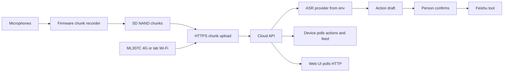

# Architecture

This page describes the code that was imported. It does not add measured
latency, battery life, or radio certification.

The device is a 4G cellular voice terminal. “4G” here is the mobile
network, not a 4 GB memory or storage label. Firmware comments and the
manufacturing notes identify the modem path as ML307C-GC on an ESP32-S3.
The UK SIM work in firmware `1.0.27-uk.1` selects APNs. `Kconfig.projbuild`
says that APN adaptation is not a claim that the module's bands were
verified on a UK live network.

A static copy of the same flow is `docs/dataflow.svg`.

## What the server entry actually wires

`voxmind-source-available/snapshot/cloud/src/index.ts` builds the process:

- High-priority ASR follows `ASR_PROVIDER`: `dashscope` (HTTP audio API),
  `aliyun`, or the mock provider.
- Economy ASR uses a DashScope WebSocket (`DashScopeRealtimeAsrProvider` in
  `cloud/src/asr/index.ts`) only when `ECONOMY_ASR` is `funasr` or
  `paraformer` and `DASHSCOPE_API_KEY` is set. Otherwise economy ASR falls
  back to the high-priority provider.
- `SenseVoice` is selected only when `ECONOMY_ASR=sensevoice` and
  `SENSEVOICE_URL` is set.
- Transcription runs in `TranscriptionService`, started when processing is
  enabled and ASR is not `disabled`.

No production environment file was read for this release. Whether a
deployed unit currently uses the WebSocket provider is a deployment fact,
not something this source tree can assert. The WebSocket class exists. It
is optional.

`cloud/src/pipeline.ts` still contains `processRecording`, which calls
`asr.transcribe` on decoded PCM and can push through an MQTT
`DeviceChannel`. Nothing under `cloud/src` imports that function from the
server entry. Do not describe MQTT push as the path the current process
uses.

## Device behavior taken from firmware

- `VOXMIND_CHUNK_SECONDS` defaults to 5. Push-to-talk can end a chunk
  early; `TALK_TAIL_MS` is 1500.
- Chunks are uploaded to `/v1/device-sessions/:id/chunks/:seq`.
- Card and command polling is `voxmind_command_poll_ms` in
  `firmware/components/app_cloud/include/command_runtime.h`:
  - 750 ms while interactive
  - 1500 ms when the screen is not off
  - 15000 ms when the screen is off
- The same task can then request `/v1/device-feed`. That is still pull,
  not a server push socket.
- Comments in `cloud/src/app.ts`, `cloud/src/services/reminders.ts`, and
  the 2026-10-02 handoff still say polls of about 1.5–4.5 seconds. The
  function above does not return 4500. The comments and the function
  disagree. The function is what the firmware compiles.

## Web UI

`cloud/web/PRODUCT.md` says real-time push is not implemented and the UI
polls. Intervals present in the page source include:

- Today, pending drafts: 5000 ms (`pages/app/Today.tsx`)
- Today, settled list: 15000 ms
- Task center: 30000 ms (`pages/app/Tasks.tsx`)
- Recording list: 30000 ms; an open timeline uses 8000 ms while following
  and 20000 ms otherwise (`pages/app/Recordings.tsx`)
- Shell pending-count poll: 15000 ms (`web/src/main.tsx`)

`cloud/src/app.ts` comments the same 5 / 20 / 30 second idea and adds ETag
responses for browser GETs. Device routes skip that ETag.

## Two firmware lines

The snapshot is the UK cellular line, version `1.0.27-uk.1`.

The power-off drain line (`1.0.27-power.1`) is only under
`candidates/power-off-drain` and `patches/`. It is not applied. Both lines
change overlapping firmware and cloud files, and both have a different
`docs/31`. Combining them needs a deliberate merge, not a copy.

## Hardware

Manufacturing history is versioned on disk. Read
`docs/IMPORT-MANIFEST.md` before ordering a board. v9's own README says to
order v9 rather than v8. This import did not run DRC and did not receive
the enclosure v2 print project.
