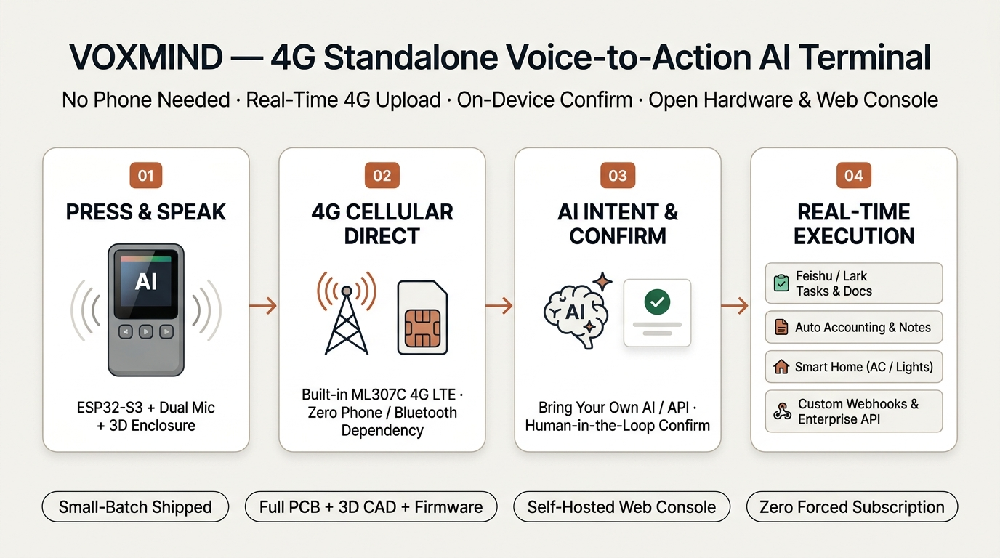
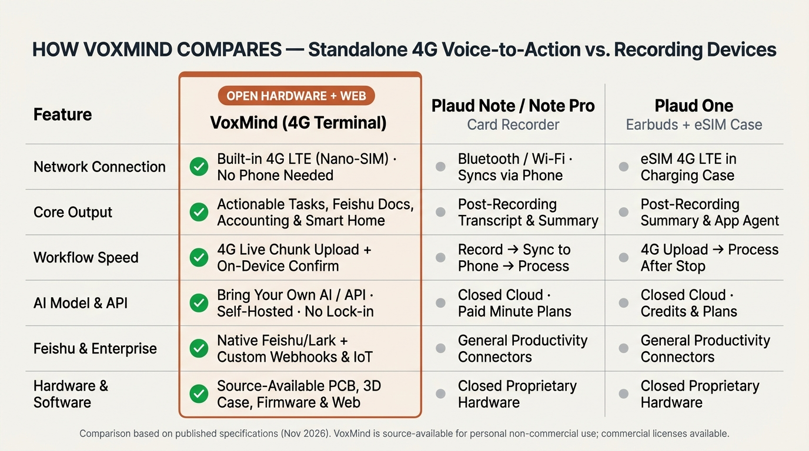

# VoxMind · Eigenständiges 4G-KI-Sprachterminal

[中文](../README.md#中文) · [English](../README.md#english) · [日本語](../README.md#日本語) · [Español](README.es.md) · **Deutsch** · [한국어](README.ko.md) · [Français](README.fr.md)

  

## Was ist VoxMind?

**VoxMind** ist ein **eigenständiges KI-Sprach-Aktions-Terminal mit integriertem 4G-LTE-Mobilfunk** (Nano-SIM – nicht „4 GB“ Speicher). Kein Smartphone, kein Bluetooth-Tethering, kein WLAN erforderlich.

Drücken und sprechen: VoxMind lädt Sprache direkt über 4G hoch, erkennt deine Absicht mit deinem eigenen KI-Modell, zeigt eine Bestätigungskarte auf dem 2-Zoll-Farb-Touchscreen an und führt **Feishu/Lark-Aufgaben, Nachrichten, Dokumente, automatische Buchhaltung, Smart-Home-Steuerung (Klimaanlage/Licht) sowie benutzerdefinierte Unternehmens-APIs & Webhooks** in Echtzeit aus.

## Echte Hardware · Kleinserienfertigung & bewährter Betrieb

- **Ausgereifte physische Hardware**: Eigene 4-Lagen-Leiterplatte (ESP32-S3 + ML307C 4G-Modem + Dual-Mikrofon + Touchscreen), **3D-gedrucktes Gehäuse (v1 & v2 STEP/STL enthalten)**, in Kleinserie gefertigt, bereits verkauft und stabil im Alltagseinsatz.
- **Fertiges Gerät kaufen**: Verfügbar über Xianyu — **[VoxMind 4G Voice AI Terminal](https://m.tb.cn/h.jMFxNbJ?tk=qkTU6TNvVOc)**.
- **Interaktive Online-Demo**: Teste die Web-Konsole direkt im Browser mit isolierten Beispieldaten (keine Verbindung zu echter Hardware) 👉 **[Interaktive Demo öffnen](https://feishubanlv.com/voxmind/demo/#de)**.
- **Vollständiger Stack veröffentlicht**: EasyEDA-Projekt, v9-Gerber/BOM/CPL, 3D-Gehäuse-CAD, ESP-IDF-Firmware, TypeScript-Backend & Web-Konsole (vollständig bereinigt, ohne API-Schlüssel oder private Gerätedaten).

## Vergleich mit Plaud (Note / Note Pro / One)

  

- **Direktes 4G LTE statt Smartphone-Abhängigkeit**: Plaud Note / Note Pro synchronisieren über Bluetooth/WLAN per Smartphone; VoxMind arbeitet direkt über das integrierte 4G-Modul (Plaud One bietet eSIM 4G LTE im Ladecase).
- **Aktion statt nur Zusammenfassung**: Erstellt direkt Feishu/Lark-Aufgaben, Buchungen, Smart-Home-Befehle und individuelle Webhook-Workflows mit Bestätigung am Gerät.
- **Eigene KI & kein Abo-Zwang**: Nutze deine eigenen KI-APIs und eigenes Hosting – ohne monatliche Minutenpakete.

## Echte Praxisvideos (Douyin)

- 🎬 [Smart-Home-Steuerung per Sprache: Klimaanlage per VoxMind schalten](https://www.douyin.com/video/7695388211157159203)
- 🎬 [Eigene KI-Hardware: Feishu, Smart Home & Unternehmenssysteme](https://www.douyin.com/video/7694328346280234274)
- 🎬 [VoxMind Live-4G-Demo: Aufgaben, Buchhaltung & Bestätigung auf dem Display](https://www.douyin.com/video/7691974175644339502)
- 🎬 [3D-Gehäusedruck & 4G-IoT-Agenten-Integration](https://www.douyin.com/video/7690610993400382395)

## Kundenspezifisches Hardware-Design & kommerzielle Lizenz (WhatsApp)

Du brauchst **maßgeschneidertes KI-Hardware-Design** (PCB, 3D-Gehäuse, Firmware, Web-Backend) oder eine **kommerzielle Lizenz** für VoxMind? Kontaktiere mich direkt über WhatsApp:

- 💬 **WhatsApp**: **[+86 177 0357 5241](https://wa.me/8617703575241)** (`https://wa.me/8617703575241`)
- 🌐 **Website & Kontakt**: [https://buildwithneo.cn/#contact](https://buildwithneo.cn/#contact)
- ✉️ **E-Mail**: `neo.gannianlin@gmail.com`

## Lizenz

Quellcode und Hardware-Dateien sind **Source-Available für die persönliche, nicht kommerzielle Nutzung** durch natürliche Personen (keine OSI-Open-Source-Lizenz). Kommerzielle Nutzung erfordert eine separat erworbene schriftliche Lizenz des Autors. Vollständiger Text: [LICENSE.md](../LICENSE.md) · Drittanbieterhinweise: [NOTICE](../NOTICE).
