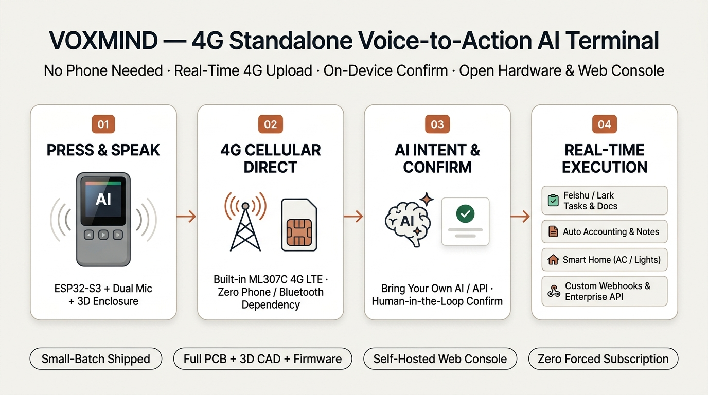
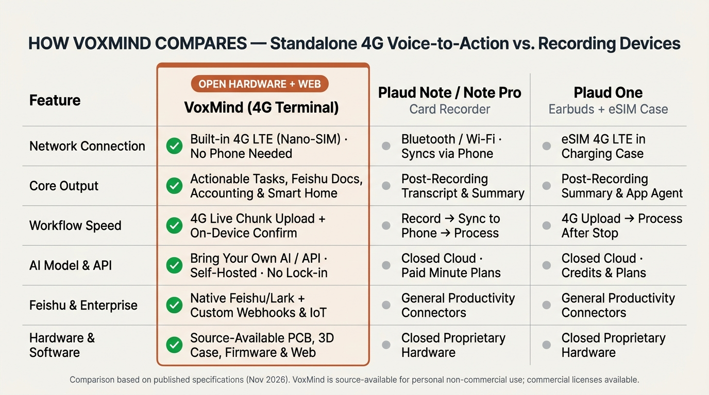

# VoxMind · Terminal de Voz IA 4G Independiente

[中文](../README.md#中文) · [English](../README.md#english) · [日本語](../README.md#日本語) · **Español** · [Deutsch](README.de.md) · [한국어](README.ko.md) · [Français](README.fr.md)

  

## ¿Qué es VoxMind?

**VoxMind** es un **terminal físico de voz IA con conectividad celular 4G LTE integrada** (Nano-SIM, no "4 GB" de memoria). Funciona de forma totalmente independiente, sin teléfono, sin Bluetooth y sin Wi-Fi.

Presiona y habla: VoxMind captura audio en tiempo real por 4G para que puedas **ver la transcripción al instante durante entrevistas o revisar el texto completo y el resumen al terminar**, generar **resúmenes automáticos de visitas comerciales**, conectar **tu propia IA/API**, ejecutar tareas y contabilidad en Feishu/Lark y **extenderse para controlar cualquier dispositivo** (domótica, interruptores IoT, equipos agrícolas o sistemas empresariales). Todo lo que ofrecen los grabadores Plaud, más el **4G celular independiente** que Plaud Note / Note Pro no tienen, con hardware, carcasa 3D, firmware y consola web disponibles (uso personal no comercial).

## Hardware real · Producción en pequeños lotes y envíos reales

- **Dispositivo físico real y estable**: PCB personalizado de 4 capas (ESP32-S3 + módem 4G ML307C + doble micrófono + pantalla táctil), carcasa impresa en 3D (archivos v1 y v2 STEP/STL incluidos), probado en uso diario y ya vendido en pequeños lotes.
- **Comprar unidad física**: Disponible en Xianyu — **[VoxMind 4G Voice AI Terminal](https://m.tb.cn/h.jMFxNbJ?tk=qkTU6TNvVOc)**.
- **Demo interactiva en línea**: Prueba la consola web con datos sintéticos aislados (sin conexión a dispositivos reales) 👉 **[Abrir Demo Interactiva](https://feishubanlv.com/voxmind/demo/#es)**.
- **Stack completo disponible**: PCB (EasyEDA/Gerber/BOM), carcasa 3D (STEP/STL), firmware ESP-IDF, backend TypeScript y consola web (sin claves ni credenciales privadas).

## Comparativa con Plaud (Note / Note Pro / One)

  

- **4G LTE integrado frente a sincronización por teléfono**: Plaud Note / Note Pro dependen de Bluetooth/Wi-Fi vía smartphone; VoxMind sube directamente por red celular 4G independiente (Plaud One ofrece eSIM 4G LTE en su estuche).
- **De grabadora a terminal de acción**: No se limita a resumir grabaciones; ejecuta tareas en Feishu/Lark, contabilidad, domótica y APIs personalizadas con confirmación en pantalla.
- **Tu propia IA, sin suscripción obligatoria**: Conecta tus propias claves API o aloja tu servidor sin bloqueos ni cuotas mensuales por minutos.

## Videos reales en funcionamiento (Douyin)

- 🎬 [Control de aire acondicionado por voz con VoxMind](https://www.douyin.com/video/7695388211157159203)
- 🎬 [Hardware IA propio: Feishu, domótica y sistemas empresariales](https://www.douyin.com/video/7694328346280234274)
- 🎬 [Demo en vivo 4G: tareas, contabilidad y confirmaciones en pantalla](https://www.douyin.com/video/7691974175644339502)
- 🎬 [Impresión de carcasa 3D e integración de agentes por 4G](https://www.douyin.com/video/7690610993400382395)

## Diseño de hardware a medida y licencia comercial (WhatsApp)

¿Necesitas **diseño de hardware IA a medida** (PCB, carcasa 3D, firmware, consola web) o una **licencia comercial** de VoxMind? Escríbeme directamente:

- 💬 **WhatsApp**: **[+86 177 0357 5241](https://wa.me/8617703575241)** (`https://wa.me/8617703575241`)
- 🌐 **Web y contacto**: [https://buildwithneo.cn/#contact](https://buildwithneo.cn/#contact)
- ✉️ **Correo**: `neo.gannianlin@gmail.com`

## Licencia

Código y diseño **disponibles para uso personal y no comercial** por personas físicas (no es una licencia de código abierto OSI). El uso comercial requiere una licencia escrita adquirida al autor. Texto completo en [LICENSE.md](../LICENSE.md) y avisos de terceros en [NOTICE](../NOTICE).
