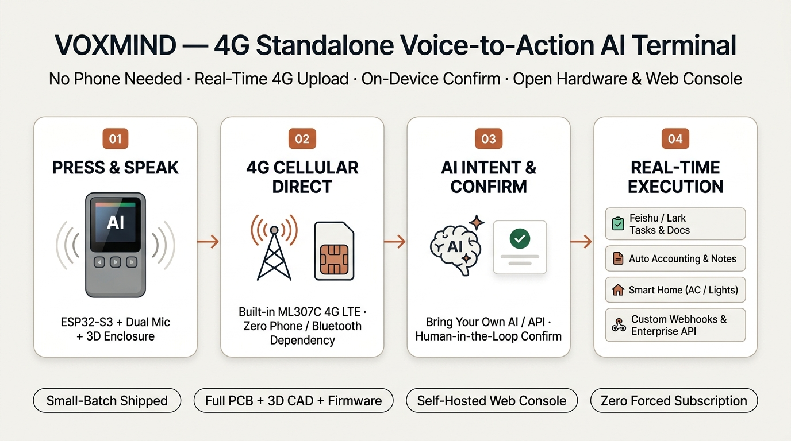
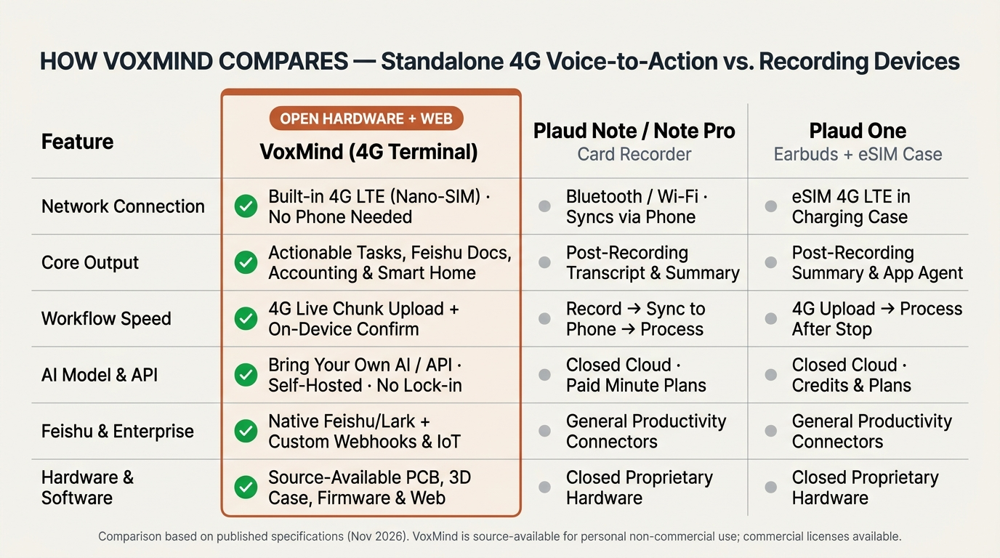

# VoxMind · Terminal Vocal IA 4G Autonome

[中文](../README.md#中文) · [English](../README.md#english) · [日本語](../README.md#日本語) · [Español](README.es.md) · [Deutsch](README.de.md) · [한국어](README.ko.md) · **Français**

  

## Qu'est-ce que VoxMind ?

**VoxMind** est un **terminal vocal IA autonome avec connectivité cellulaire 4G LTE intégrée** (Nano-SIM — et non « 4 Go » de mémoire). Sans téléphone, sans Bluetooth et sans Wi-Fi requis.

Appuyez et parlez : VoxMind transmet votre voix en direct via 4G, analyse votre intention avec le modèle d'IA de votre choix, affiche une carte de confirmation sur son écran tactile couleur de 2 pouces et exécute immédiatement **des tâches Feishu/Lark, messages, documents, suivi automatique de dépenses, commandes domotiques (climatisation/éclairage) et API/webhooks d'entreprise**.

## Matériel réel · Petite série produite, expédiée et éprouvée

- **Produit physique abouti et stable** : PCB 4 couches sur mesure (ESP32-S3 + modem 4G ML307C + double microphone + écran tactile), **boîtier imprimé en 3D (fichiers v1 & v2 STEP/STL inclus)**, fabriqué en petite série, déjà vendu et utilisé au quotidien.
- **Acheter une unité physique** : Disponible sur Xianyu — **[VoxMind 4G Voice AI Terminal](https://m.tb.cn/h.jMFxNbJ?tk=qkTU6TNvVOc)**.
- **Démo interactive en ligne** : Essayez la console web dans votre navigateur avec des données synthétiques isolées 👉 **[Ouvrir la démo interactive](https://feishubanlv.com/voxmind/demo/#en)**.
- **Pile complète disponible** : PCB (EasyEDA/Gerber/BOM), boîtier 3D (STEP/STL), firmware ESP-IDF, backend TypeScript et console web (sans aucune clé secrète ni identifiant privé).

## Comparaison avec Plaud (Note / Note Pro / One)

  

- **4G LTE autonome vs synchronisation smartphone** : Plaud Note / Note Pro passent par le smartphone en Bluetooth/Wi-Fi ; VoxMind dispose de sa propre connexion 4G LTE intégrée (Plaud One intègre une eSIM 4G LTE dans son boîtier de charge).
- **Passer à l'action plutôt que simplement résumer** : Crée des tâches Feishu/Lark, enregistre des dépenses, pilote la domotique et déclenche des API métier avec validation directe à l'écran.
- **Votre propre IA, sans abonnement imposé** : Utilisez vos propres clés API ou votre serveur auto-hébergé, sans forfait de minutes obligatoire.

## Vidéos de démonstration réelles (Douyin)

- 🎬 [Pilotage domotique à la voix : climatisation contrôlée par VoxMind](https://www.douyin.com/video/7695388211157159203)
- 🎬 [Matériel IA conçu de A à Z : Feishu, domotique et systèmes d'entreprise](https://www.douyin.com/video/7694328346280234274)
- 🎬 [Démo réelle 4G : tâches, comptabilité et notifications sur l'écran](https://www.douyin.com/video/7691974175644339502)
- 🎬 [Impression 3D du boîtier et connexion aux agents IA via 4G](https://www.douyin.com/video/7690610993400382395)

## Conception matérielle sur mesure & licence commerciale (WhatsApp)

Besoin d'une **conception matérielle IA sur mesure** (PCB, boîtier 3D, firmware, backend) ou d'une **licence commerciale** VoxMind ? Contactez-moi directement sur WhatsApp :

- 💬 **WhatsApp** : **[+86 177 0357 5241](https://wa.me/8617703575241)** (`https://wa.me/8617703575241`)
- 🌐 **Site web & contact** : [https://buildwithneo.cn/#contact](https://buildwithneo.cn/#contact)
- ✉️ **E-mail** : `neo.gannianlin@gmail.com`

## Licence

Code et fichiers matériels **Source-Available pour un usage personnel et non commercial** par des personnes physiques uniquement (il ne s'agit pas d'une licence open source OSI). Tout usage commercial nécessite une licence écrite payante obtenue auprès de l'auteur. Voir [LICENSE.md](../LICENSE.md) et [NOTICE](../NOTICE).
