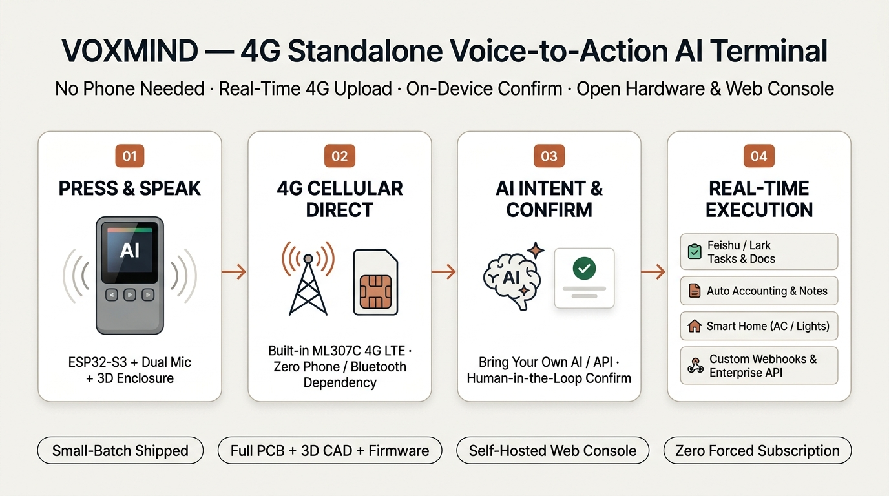
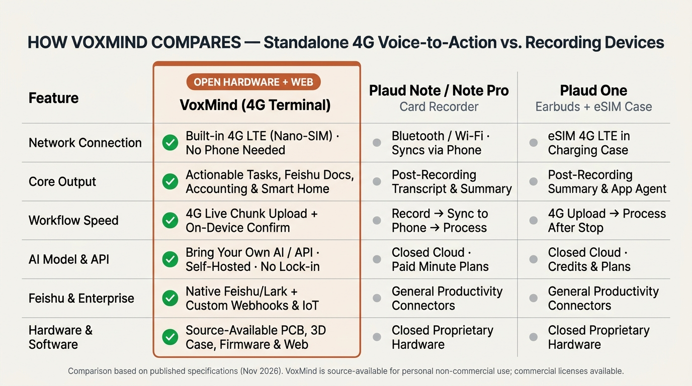

# VoxMind · 독립형 4G AI 음성 액션 단말기

[中文](../README.md#中文) · [English](../README.md#english) · [日本語](../README.md#日本語) · [Español](README.es.md) · [Deutsch](README.de.md) · **한국어** · [Français](README.fr.md)

  

## VoxMind 소개

**VoxMind**는 **4G LTE 셀룰러 모듈(Nano-SIM)을 내장한 휴대용 AI 음성 액션 하드웨어 단말기**입니다. 스마트폰 블루투스나 Wi-Fi 연결 없이도 실시간 수음으로 **인터뷰 중 즉시 텍스트를 확인하거나 종료 후 전체 텍스트와 요약을 확인**할 수 있으며, **영업 방문 자동 요약**, **커스텀 AI/API 연동**, Feishu(Lark) 업무·가계부 실행은 물론 **만물 제어로 확장 가능**(스마트홈·IoT 스위치·농장/기업 시스템)합니다. Plaud의 핵심 기능에 카드형 Plaud(Note/Note Pro)에 없는 **독립 4G**까지 갖추고 풀스택 소스를 공개했습니다(개인 비상업적 용도).

## 실물 완성 · 소량 양산 및 실제 출하 완료

- **검증된 실물 하드웨어**: 자체 설계 4층 PCB(ESP32-S3 + ML307C 4G LTE + 듀얼 마이크 + 터치스크린)와 **3D 프린팅 케이스(v1 & v2 STEP/STL 포함)**, 소량 양산·실제 판매 출하 및 안정적인 일상 구동을 검증했습니다.
- **실물 제품 구매**: Xianyu에서 수제작 완제품 구매 가능 👉 **[VoxMind 4G AI 음성 단말기](https://m.tb.cn/h.jMFxNbJ?tk=qkTU6TNvVOc)**
- **온라인 인터랙티브 데모**: 브라우저에서 바로 체험(완전 합성 데이터, 실물 기기 미연결) 👉 **[웹 콘솔 데모 열기](https://feishubanlv.com/voxmind/demo/#en)**
- **풀스택 소스 공개**: PCB(EasyEDA/Gerber/BOM), 3D 케이스 CAD, ESP-IDF 펌웨어, TypeScript 백엔드 및 웹 콘솔 일체 공개(API 키 및 개인 기기 정보 완전 제거).

## Plaud(Note / Note Pro / One)와의 비교

  

- **스마트폰 없는 독립 4G 연결**: Plaud Note/Note Pro는 블루투스/Wi-Fi로 스마트폰 동기화가 필요하지만, VoxMind는 내장 4G LTE로 단독 동작합니다(Plaud One은 충전 케이스에 eSIM 4G LTE 탑재).
- **단순 녹음 요약을 넘어 실시간 실행까지**: 녹음 후 요약에 그치지 않고 Feishu 업무, 자동 기록, 스마트홈 및 기업 API 연동을 기기 화면 확인과 함께 처리합니다.
- **자유로운 AI / API 선택 · 월 구독 강제 없음**: 본인 API 키 또는 자체 서버를 자유롭게 연결할 수 있습니다.

## 실물 동작 영상 (Douyin)

- 🎬 [자체 제작 AI 하드웨어로 한마디에 에어컨 제어](https://www.douyin.com/video/7695388211157159203)
- 🎬 [AI 하드웨어 실기 데모: Feishu 전송·스마트홈·기업 시스템 연동](https://www.douyin.com/video/7694328346280234274)
- 🎬 [VoxMind 4G 실기 시연: 업무 생성·자동 가계부·실시간 화면 알림](https://www.douyin.com/video/7691974175644339502)
- 🎬 [3D 프린팅 외장 케이스 및 4G 에이전트 연동](https://www.douyin.com/video/7690610993400382395)

## 맞춤형 하드웨어 설계 및 상업용 라이선스 문의 (WhatsApp)

**AI 하드웨어 맞춤형 설계(PCB, 3D 케이스, 펌웨어, 클라우드)** 또는 **VoxMind 상업용 라이선스**가 필요하신 경우 WhatsApp으로 직접 문의해 주세요:

- 💬 **WhatsApp**: **[+86 177 0357 5241](https://wa.me/8617703575241)** (`https://wa.me/8617703575241`)
- 🌐 **웹사이트**: [https://buildwithneo.cn/#contact](https://buildwithneo.cn/#contact)
- ✉️ **이메일**: `neo.gannianlin@gmail.com`

## 라이선스

본 프로젝트는 **개인 비상업적 용도 전용 소스 공개(Source-Available)** 라이선스입니다(OSI 오픈소스 라이선스가 아닙니다). 상업적 이용에는 작성자의 별도 유료 서면 허가가 필요합니다. 전문은 [LICENSE.md](../LICENSE.md) 및 [NOTICE](../NOTICE)를 참고하세요.
