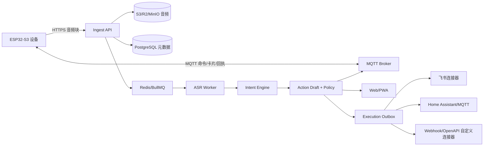

# VoxMind 开放平台产品与技术架构 v1

**状态：当前主方案（替代早期“按键录完后一次上传、固定 Claude、30 秒等待窗口”的方案）**  
**日期：2026-09-12**

## 0. 结论

VoxMind 不应只是“录音后让 AI 建一条飞书任务”，而应做成一个**本地优先、持续同步、可确认执行的语音操作系统**：

- 设备开机即持续录音；音频先安全落本地，再按小块上传，断网可续传。
- 云端持续转写和理解，产出“动作草稿”，而不是让模型直接调用外部系统。
- 动作是否自动执行由确定性的策略引擎决定；模型只能提出动作和参数，不能降低权限。
- 屏幕、Web、飞书卡片是同一个确认队列的不同界面，任一处处理后其余界面同步。
- 飞书只是第一个连接器；同一套工具协议可接日历、任务、文档、Webhook、Home Assistant/MQTT 和客户自定义 API。
- DeepSeek、MiniMax、OpenRouter、Anthropic 等只是可替换的模型供应商；ASR 与推理模型必须分开配置。

最短落地路径是：**先把“持续录音不丢 + Web 可回听”做稳，再做飞书任务/日程/文档，最后上实时卡片与开放连接器。**

---

## 1. 已有资产与真实差距

### 1.1 可以保留

| 资产 | 可复用部分 |
|---|---|
| `firmware/` | ESP32-S3、双 PDM 麦、SD NAND、ML307C、按键/反馈和 bring-up 骨架；具体 v9 接线以到货指南为准 |
| `cloud/src/types.ts` | Zod 结构化契约、动作分级思想、双通道队列雏形 |
| `cloud/src/push/feishu.ts` | 飞书卡片创建/更新思路 |
| `cloud/src/push/mqtt.ts` | 设备下行通道雏形 |
| `/Volumes/neo/projects/飞书saas` | OAuth Device Authorization Grant 一键创建应用、Secret 加密保存、应用配置与审计流程 |
| `/Users/neo/Desktop/CYZ100看板系统` | 飞书 Task v2 映射、卡片回调兼容解析、AI 结果先填表再修改的交互思路 |

### 1.2 不能直接沿用

- 固件当前仍是 bring-up/驱动骨架：没有持续录音器、Opus 分段、掉电日志、断点上传、PPP/HTTPS、触摸 UI。
- 云端当前接收整段录音并一次性处理，ASR 是 TODO，卡片确认后也没有真正执行动作。
- 云端用内存 `Map`，重启即丢；接口无设备鉴权、无对象存储、无回调验签、无幂等执行记录。
- 意图分类硬编码单一 Anthropic 模型，固定 A/B/C 映射无法表达用户要求的“后台可切换是否确认”。
- CYZ100 的浏览器侧模型调用方式不能复用：模型密钥必须立即移到服务端；仓库中出现过的旧密钥应轮换。

### 1.3 v9 实板参数修正

v9 BOM 的 U9 是 **MKDV4GIL-AST（LCSC C26159626）**，规格为 **4 Gbit = 512 MB**，支持 SD 接口/SPI，现有 ESP-IDF `sdspi` 方向正确。旧文档中的“1 GB、140 小时”不适用于实板。

按 16 kbps Opus 计算：

- 理论：约 71 小时；
- 预留 20% 给文件系统、日志、坏块和安全水位后：约 **57 小时**；
- 若保存 32 kbps 双声道/高质量音频：安全容量约 **28 小时**。

首版建议：双麦 PCM 先做增益/降噪/波束处理，归档为 16 kHz 单声道 16–24 kbps Opus；是否保留原始双声道作为调试选项。

---

## 2. 产品模型

### 2.1 四种语音结果

每一段转写只能进入以下一种或多种结果，不能把“有意图”直接等同于“执行”：

1. **仅记录**：普通谈话，保存音频和转写，不打扰用户。
2. **建议动作**：像任务但没有明确命令，生成待确认卡片。
3. **明确命令**：用户明确说“直接创建飞书任务……”，按该动作的策略自动执行或确认。
4. **会话结束动作**：如“今天录完后生成纪要”，挂到当前会话，结束后执行。

### 2.2 动作草稿不是执行结果

统一数据模型：

```text
录音片段 → 转写片段 → 意图候选 → ActionDraft(r1/r2/…) → Approval → Execution → Receipt
```

`ActionDraft` 至少包含：

- `tool`: `feishu.task.create`、`feishu.calendar.create`、`iot.light.set` 等稳定工具名；
- `args`: 经过 JSON Schema 校验的参数；
- `mode`: `suggested | explicit | deferred`；
- `evidence`: 原话、音频时间范围、ASR 置信度；
- `risk`: 由工具注册表给出，模型不得修改；
- `revision` 与 `baseRevision`：支持只说差异的语音修改；
- `idempotencyKey`：避免断线重试创建两遍任务或日程。

### 2.3 “确定”的准确语义

“确定”只确认**当前屏幕最上层卡片**，并同时满足：

- 设备刚播报/显示过该卡片；
- 在可配置短窗口内（建议 15 秒）；
- 没有更晚的打断或另一张卡成为焦点；
- 高风险工具仍须触屏确认，不能只靠环境中的一句“确定”。

“开灯，确定”可在同一语义片段内直接执行；孤立的“确定”不能确认后台任意旧卡片。

### 2.4 修改卡片

用户点“修改”后，设备进入 `correction` 录音模式，但主录音继续：

1. 屏幕显示“正在修改：创建飞书任务”；
2. 用户可只说“时间改到明天下午三点，负责人不变”；
3. 云端将该语音与 `ActionDraft r1` 一起提交给模型；
4. 模型只返回 JSON Patch/结构化差异；服务端合并并重新校验；
5. 生成 `r2`，重新显示完整卡片；用户确认后才执行。

原版本不覆盖，便于审计和纠错。

### 2.5 多卡片队列

- 设备只显示 FIFO 队首，右上角显示 `1 / N` 或“后面还有 N−1 条”。
- 新任务不会覆盖正在修改/确认的卡片。
- Web 可批量处理；设备提供“稍后”进入下一张，但不改变执行状态。
- 已在 Web/飞书处理的卡片通过 MQTT 立即从设备撤回。
- 每张卡显示录音仍在进行的红点，确认界面绝不能让用户误以为录音暂停。

---

## 3. 确认策略引擎

策略优先级：`用户动作覆盖 > 用户连接器覆盖 > 租户策略 > 工具默认策略`。

```ts
type ConfirmationMode = "always" | "explicit_only" | "never";

interface ToolPolicy {
  tool: string;
  risk: "record" | "personal_write" | "external_write" | "physical_control" | "destructive";
  confirmation: ConfirmationMode;
  allowVoiceConfirm: boolean;
  maxDraftAgeSec: number;
}
```

推荐默认值：

| 类型 | 示例 | 默认 |
|---|---|---|
| 只记录 | 笔记、书签、纪要草稿 | 自动 |
| 个人写入 | 自己的飞书任务、无参与人的私人日程 | 明确命令可自动；推断意图需确认 |
| 对外写入 | 发消息、邀请他人、提交审批 | 总是确认 |
| 物理控制 | 灯开关 | 明确命令 + 同句“确定”可执行 |
| 高影响/破坏性 | 门锁、删除、付款、公开发布 | 触屏/Web 强确认，禁止仅语音 |

后台应允许按工具切换，但“租户安全上限”不能被个人设置降低。

---

## 4. 持续录音与不丢数据协议

### 4.1 设备写入顺序

```text
PDM 双麦 → 音频处理 → Opus 编码 → 写 chunk.part → fsync → rename chunk.opus
                                                   ↓
                                             追加 manifest journal
                                                   ↓
                                    HTTPS 上传 → 云端持久化 ACK
                                                   ↓
                                      标记 uploaded，按保留策略回收
```

- 以 **5 秒**为逻辑分析片段、**30 秒**为归档对象较合适：低延迟与对象数量之间折中。
- 每块携带 `deviceId/sessionId/sequence/startMs/duration/sha256/codec`。
- 先本地落盘再上传；服务端只有在对象存储写成功后才 ACK。
- 上传接口按 `(deviceId, sessionId, sequence, sha256)` 幂等；重传不产生重复音频。
- 设备保存追加式 journal，不能每 5 秒重写一份大 JSON；启动时可恢复未完成队列。
- 空间达到 80% 先删“已云端确认且超过本地保留期”的最旧块；绝不删未确认上传块。95% 时告警并降低非必要日志。

### 4.2 实时与弱网

- 有网：连续上传，云端对 5 秒增量做流式/准流式 ASR，目标 P95 卡片延迟小于 15 秒。
- 弱网：指数退避，音频采集绝不能被上传阻塞。
- 断网：仅写本地；恢复后按序补传，可同时给最新音频保留一个高优先级通道。
- 服务器用重叠上下文窗口分析（例如最近 30–90 秒），但通过 `intentFingerprint` 去重，避免一句话每 5 秒生成一张卡。

### 4.3 会话结束

持续录音仍需要“逻辑会话”：

- 正常关机/用户点结束：设备先发 `session.end`，刷新最后一块，然后关机；
- 异常掉电/丢失：云端在设备心跳超时后将会话标为 `interrupted`，仍对已上传部分生成纪要；
- “录音结束后生成纪要”保存为 `deferred action`，在 `ended` 或 `interrupted` 后由云端执行，不依赖设备继续在线。

---

## 5. 总体技术架构



### 5.1 推荐技术栈

- 单仓库 TypeScript：`pnpm workspace`；保留 Fastify，Web 用 React + Vite/PWA。
- PostgreSQL：用户、设备、会话、转写、动作版本、审批、执行回执、审计。
- Redis + BullMQ：ASR、意图分析、纪要、执行 outbox 和重试。
- S3 兼容对象存储：原始音频与导出文件；本地开发用 MinIO。
- MQTT：设备状态、卡片与回执；大音频不走 MQTT。
- OpenTelemetry：从音频块到外部动作的统一 trace。

建议目录：

```text
apps/api                 Fastify 控制面/API
apps/worker              ASR、意图与执行 Worker
apps/web                 React 管理后台/PWA
packages/contracts       Zod/OpenAPI，共享事件与数据结构
packages/ai-providers    推理模型适配器
packages/asr-providers   流式/批量 ASR 适配器
packages/connectors      飞书、Webhook、Home Assistant 等
firmware/                ESP-IDF 设备端
```

先模块化单体，不要一开始拆微服务；Worker 独立进程即可。

---

## 6. 模型与 ASR 开放层

### 6.1 模型供应商

统一内部接口，不让业务代码依赖供应商 SDK：

```ts
interface ReasoningProvider {
  capabilities(): { streaming: boolean; tools: boolean; jsonSchema: boolean };
  generateObject<T>(request: StructuredRequest<T>): Promise<ModelResult<T>>;
}
```

适配顺序：

1. `OpenAICompatibleProvider`：覆盖 OpenRouter、DeepSeek 及用户自定义 `baseURL/apiKey/model/headers`；
2. `AnthropicCompatibleProvider`：覆盖原生 Anthropic 及提供兼容接口的供应商；
3. `MiniMaxProvider`：按官方文本接口能力适配；
4. 后续供应商插件。

配置必须支持：用途分流（意图/修订/纪要）、主备模型、超时、预算、熔断、重试、数据区域和“禁止供应商留存”标签。API Key 只存在服务端密钥库，绝不下发浏览器或设备。

### 6.2 ASR 独立配置

LLM 提供商不等于语音识别商。定义 `StreamingAsrProvider` 与 `BatchAsrProvider` 两种能力；首版可先接一家中文流式 ASR，再用批量 ASR 对整段归档复核。断网补传仍必须走批量模式。

### 6.3 模型输出边界

- 模型只输出候选工具名和结构化参数；服务端做 schema、权限、成员、日期、时区和业务规则校验。
- 工具列表按用户已启用连接器动态裁剪，未授权工具不进入提示词。
- 所有写操作经过策略引擎和 outbox；模型进程不能直接持有飞书或 IoT 写权限。

---

## 7. 飞书方案

### 7.1 两种适配器

| 场景 | 方式 | 原因 |
|---|---|---|
| 本机开发、个人高级玩法 | `lark-cli` 适配器 | 已安装 v1.0.80，覆盖 task/calendar/docs/minutes 等，探索能力强 |
| 正式 Web/SaaS | 飞书 OpenAPI 适配器 | 多租户、并发、审计、令牌刷新和稳定性更可控 |

CLI 适配器只能调用白名单 `argv[]`，严禁拼接 shell 字符串；每个动作先用 schema 固定参数并映射到统一工具协议。生产执行不能依赖某台开发机登录状态。

### 7.2 首批工具

- `feishu.task.create/update/complete`
- `feishu.calendar.event.create/update`
- `feishu.doc.create_from_markdown`
- `feishu.minutes.create_from_recording`
- `feishu.message.send`（默认强确认）

### 7.3 一键创建应用

将 `/Volumes/neo/projects/飞书saas/app/feishu_connect/registration.py` 的已验证流程移植到 TypeScript：

1. 后台按已启用工具计算最小 user/tenant scopes；
2. 发起官方 Device Authorization Grant，页面显示飞书官方二维码/确认链接；
3. 飞书返回 App ID/Secret 后立即加密保存，Secret 不进浏览器、日志或普通数据库字段；
4. 配置 OAuth 回调并引导发布/管理员审核；
5. 用户 OAuth 授权后做能力探测和一条只读验证；
6. 发布审核通过后才允许写操作；支持后续增量权限修复，不重复创建应用。

“一键”能完成创建和预配置，但企业发布审核、可用范围和某些权限仍受飞书管理员策略约束，界面必须明确展示状态，不能伪装成已经全部可用。

---

## 8. Web 后台与开放 API

### 8.1 后台页面

- 今日时间线：音频、转写、意图、动作结果统一回放；
- 待确认队列：编辑、确认、取消、批量处理；
- 自动化策略：按工具选择总是确认/明确命令自动/始终自动；
- 连接器中心：飞书、模型、ASR、Webhook、Home Assistant；
- 设备中心：在线、电量、网络、存储、积压块、固件版本、远程撤销；
- 隐私与保留：本地/云端保留天数、导出、删除、模型数据策略；
- 开发者中心：API Key、Webhook、OpenAPI 文档、调用日志和配额。

### 8.2 首版 API

```text
POST /v1/device-sessions
PUT  /v1/device-sessions/:id/chunks/:seq
POST /v1/device-sessions/:id/end
GET  /v1/sessions/:id/timeline
GET  /v1/action-drafts?status=pending
POST /v1/action-drafts/:id/confirm
POST /v1/action-drafts/:id/cancel
POST /v1/action-drafts/:id/revise
GET  /v1/executions/:id
POST /v1/connectors/feishu/registration
GET  /v1/connectors/feishu/registration/:id
```

公开 API 使用租户级 API Key/OAuth、细粒度 scopes、速率限制和 webhook 签名。设备 API 使用每台设备独立密钥或证书，不能只信任 header 里的 `deviceId/userId`。

---

## 9. IoT 与可扩展玩法

首选接入 Home Assistant 或用户自有 MQTT，而不是为每个灯厂商单独写协议。统一成：

- `iot.light.set({entityId, on, brightness, colorTemp})`
- `iot.climate.set_temperature({entityId, temperature})`
- `iot.scene.activate({sceneId})`

可扩展场景：

- “刚才这段标成灵感”并自动汇总到每日灵感文档；
- 识别承诺语句：“我周五前发你”→ 建个人任务并关联原音频；
- 会后生成纪要、决策、待办，并让每一项都能跳回原音频时间点；
- 地理围栏/时间条件触发提醒，但精确位置权限必须单独授权；
- 自定义 webhook 将动作草稿送进 n8n、Zapier 或客户业务系统；
- 本地规则先处理简单命令，云端模型只处理歧义和复杂任务，降低延迟与成本。

---

## 10. 隐私、安全与可靠性底线

持续录音是高敏能力，产品必须默认做到：

- 屏幕和 LED 始终有不可伪造的录音状态；提供物理停止/静音方式；
- 首次启用明确说明录音、上传、保留和第三方模型处理范围；多人场景提示当地录音与隐私规则；
- 传输 TLS，云端对象加密，Secret 使用 KMS/钥匙串；租户数据隔离；
- 音频、转写和动作采用不同保留期；支持按会话导出与删除；
- 设备丢失后可撤销设备凭证，阻止继续上传/接收指令；远程擦除只删除已确认同步的数据并需强确认；
- 飞书回调验签、事件去重、令牌刷新锁、执行 outbox 和完整审计日志；
- 所有外部写操作以唯一键执行；“网络超时、不知道成功没有”时先查询结果，不能盲目重试。

---

## 11. 分阶段实施与验收

### P0：实板 bring-up（明天线到后，0.5–1 天）

按 `交付/VoxMind_v9_到货采购装配与开发完全指南_20260830.md` 跑通电源、USB、双麦、U9、屏幕、触摸、ML307C 和电池计。`docs/10_*`、`docs/13_*` 含 v8 的 12P 屏幕座/Air780E 等历史信息，不得覆盖 v9 指南。额外记录：

- U9 实际容量、SPI 10/20/40 MHz 稳定性和连续写 30 分钟错误数；
- 双麦左右声道、底噪、削顶和间距；
- ML307C 注册网络、PPP/HTTPS 实际上行吞吐；
- 屏幕 15P 线方向、背光、触摸中断；
- 边充边录、4G 发射峰值时是否复位。

### P1：可靠录音黑匣子（3–5 天）

- 开机自动录、30 秒 Opus 文件、5 秒 manifest 节点；
- 断电恢复、循环空间管理、未上传数据永不删除；
- 连续 8 小时录音无崩溃，随机断电 50 次后文件系统可挂载且已完成块可读。

### P2：持续上云与 Web 回放（4–7 天）

- 分块幂等上传、断点续传、对象存储、Postgres 元数据；
- 时间线、播放、上传积压/设备状态；
- 模拟断网 2 小时后自动补齐，服务端无重复块；云端 ACK 前设备不回收。

### P3：实时理解与飞书最小闭环（5–8 天）

- 一家流式 ASR + 模型 provider 抽象；
- 飞书一键创建/授权；任务、私人日程、Markdown 文档；
- 明确“直接创建”按策略执行，隐含任务生成卡片；每次执行有回执和幂等键。

### P4：触屏卡片与语音修改（5–8 天）

- 240×320 队首卡、队列计数、确认/取消/修改；
- delta-only 语音修订、版本记录、跨设备/Web/飞书同步；
- 主录音不因卡片或修订录音中断。

### P5：开放平台与 IoT（后续）

- 自定义 OpenAI-compatible 模型、Webhook/OpenAPI 工具、开发者 API；
- Home Assistant/MQTT；多租户配额、审计和数据治理。

---

## 12. 当前需要产品负责人最终选择的三项

这些不阻塞 P0–P2，暂按推荐默认值实施：

1. **云端音频保留期**：推荐 30 天；转写/纪要长期保留，用户可单独删除。
2. **首发形态**：推荐先做个人单用户，再把数据模型按多租户设计；不要一开始做完整计费 SaaS。
3. **私人任务/日程默认策略**：推荐“明确说直接创建时自动，系统推断时确认”；对外消息/邀请永远确认。

---

## 13. 本次调研依据

- v9 BOM：`制造文件_v9_20260830/VoxMind_EVT_V1_v9_BOM.xlsx`
- v9 到货与硬件主指南：`交付/VoxMind_v9_到货采购装配与开发完全指南_20260830.md`
- 历史硬件真值参考：`docs/10_硬件接线真值表.md`（以 v9 指南的更正表为准）
- 现有固件：`firmware/`
- 现有云端：`cloud/src/`
- 飞书一键创建参考：`/Volumes/neo/projects/飞书saas/app/feishu_connect/registration.py`
- 飞书 CLI：本机 `lark-cli 1.0.80`
- 飞书任务参考：`/Users/neo/Desktop/CYZ100看板系统/eis-deploy/server/src/integrations/feishu/taskSync.js`
- [LCSC MKDV4GIL-AST / C26159626](https://www.lcsc.com/product-detail/C26159626.html)
- [DeepSeek API 文档](https://api-docs.deepseek.com/)
- [MiniMax 开放平台文档](https://platform.minimax.cn/docs/guides/models-intro)
- [OpenRouter Quickstart](https://openrouter.ai/docs/quickstart)
